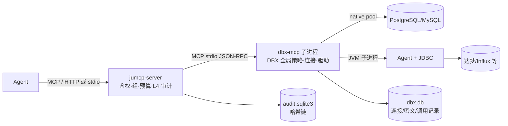
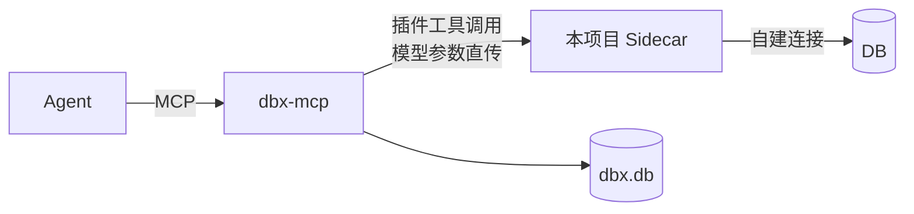
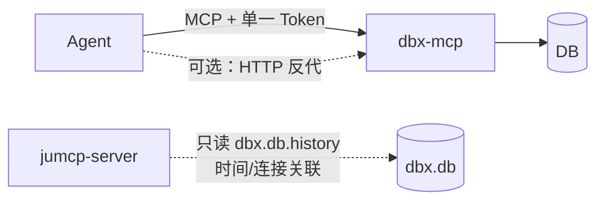
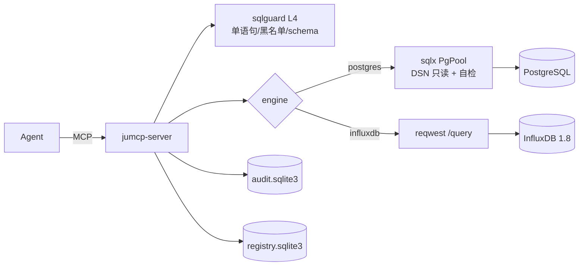
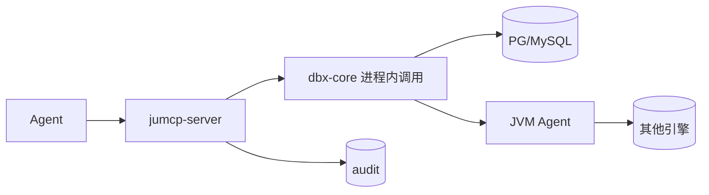

# 调研：把数据面委托给 DBX 的边界

对象：`t8y2/dbx`（Apache-2.0）。本笔记回答「连接配置 / 查询执行 / 数据源管理」能否整体交给 DBX，以及本项目应作为 DBX 的挂载、插件、前置，还是保留独立服务。
结论只针对**数据面**；治理面（身份、组、预算、注册表、审批留痕、审计链）不在可委托范围内。

## 0. 结论

**判定：有条件可以，但不能整体委托。DBX 只能作为受管执行后端，不能成为治理前门。**

- **推荐拓扑**：生产形态维持 **D（独立服务 + 自研执行器）**；需要扩展本项目未实现的引擎时，先补自研执行器（`jumcp-sqlguard` 已支持 MySQL/ClickHouse 方言），只有在**不打算长期维护该引擎**时才用 **A 的窄化形态**（本项目 MCP 前门 → DBX 执行后端），且只允许「无绑定参数、无模板、单引擎、**≤100 行**」的探索型查询。
- **现在就能替**：连接目录与 schema 元数据的**只读浏览**（DBX 自带 `dbx_list_databases/list_tables/describe_table/get_schema_context`，本项目目前没有元数据工具）；**≤100 行、无参数**的探索型只读查询（结构化只能走 `dbx_execute_batch`，固定 100 行；要 100–1000 行只能解析 `dbx_execute_query` 的文本，不推荐）。
- **需要改造后才能替**：多引擎执行（要新增适配层、错误映射、结果整形、进程监管、版本探针）；token 预算（DBX 只夹紧行数与单格字符，不计量 token）；审计关联（DBX 只有本地调用记录，无哈希链、无导出接口）。
- **不能替**：**模板参数绑定**（DBX 的 MCP/CLI/核心 API 只接受 SQL 文本，没有任何绑定参数入口）；**>100 行的结构化结果**（batch 固定 100 行且无 `max_rows`；query 有 `max_rows` 但只回文本）；**审批留痕与版本化注册表**；**按 agent/租户的身份与授权**（DBX 单 workspace、HTTP 单 Bearer Token）；**哈希链审计**；**单语句 + 完整危险函数黑名单**（DBX 只做语句种类分级，纯读多语句放行，函数清单不含 `pg_read_file` 等）。
- **本项目不应作为 DBX 插件**：插件机制真实存在，但只暴露工具，且 Web/Docker 后端不提供插件工具；DBX 会把模型参数直接交给插件，绕过本项目的鉴权、组裁剪、预算与审计，等于制造第二条调用面（违反计划 §2.9）。
- **否决红线**（任一成立即放弃该拓扑）见 §6.3。最硬的一条：**为了调用 DBX 而把参数值拼接进 SQL 文本**。

---

## 1. 核验对象与方法

| 项 | 值 | 证据 |
|---|---|---|
| 上游仓库 | `t8y2/dbx`，Apache-2.0，默认分支 `main` | GitHub API `repos/t8y2/dbx` |
| MCP 二进制版本 | `dbx-mcp 0.4.141` | 本机 `C:/Users/Nn/.dbx/bin/dbx-mcp.exe --version`；`C:/Users/Nn/.dbx/bin/.dbx-mcp-version` 内容 `0.4.141`；`crates/dbx-mcp/Cargo.toml` 版本同为 `0.4.141` |
| 桌面端发布版本 | `v0.6.68`（2026-11-07） | GitHub Releases latest；**与 MCP 二进制分开版本化** |
| npm MCP 包 | `@dbx-app/mcp-server@0.4.141` | registry.npmjs.org |
| 本机连接库 | `C:/Users/Nn/AppData/Roaming/com.dbx.app/dbx.db`（SQLite，21 条连接、20 条密文） | 只读 `mode=ro` 打开，未读取任何 secret 值 |
| 本机 Agent 运行时 | `C:/Users/Nn/.dbx/agents/state.json`：JRE `21.0.12+kerberos.ec.2`，已装 `rabbitmq/dameng/vastbase` | 本地文件 |
| 核验方式 | GitHub raw 源码/文档 + 本地二进制字符串 + 本地 `dbx.db` 只读查询 | 不写 DBX 数据、不读 token/密码 |

> 版本差异是真实风险：应用 `0.6.68` 与 MCP `0.4.141` 不是同一版本号，且 MCP 二进制由 DBX 的「接入方式」页安装/升级。任何委托方案都必须钉住 **MCP 二进制版本 + `DBX_DATA_DIR`**，不能跟随桌面端自动升级。

---

## 2. DBX 实际提供什么

### 2.1 形态与传输

- **独立进程的 MCP Server**：`dbx-mcp` 支持 `stdio` 与 **Streamable HTTP**（`/mcp`）。源码 `crates/dbx-mcp/src/main.rs` 的 `run()` 按 `McpTransport::{Stdio, StreamableHttp}` 分派；HTTP 路由见 `crates/dbx-mcp/src/http.rs` 的 `streamable_http_router`。
- **数据来源两种模式**：本地直接打开 `dbx.db`（`LocalBackend::open`），或连远端 DBX Web（`DBX_WEB_URL` + `DBX_WEB_PASSWORD`，`WebBackend`）。
- **不需要桌面端即可执行**：本地查询走 `dbx-core` 驱动；桌面端只在「高危确认」「插件重载」等路径通过 `mcp-bridge-port` 访问（`crates/dbx-mcp/src/backend.rs` 的 `approve_high_risk_sql` / `bridge_request`）。只读策略下写路径先被拒绝，不会触发桌面确认。
- **Resources**：`dbx://connections`、`dbx://connections/{id}/databases`、`.../tables`、`.../table-schema`（`docs/content/docs/mcp.cn.mdx` §Resources）。

### 2.2 工具集合与 schema（关键约束）

内置工具由 `crates/dbx-core/src/ai/mcp_catalog.rs` 的 `TOOLS` 声明，共 **50 个**，另加插件工具。分组为 `core.discovery` / `sql.query` / `sql.session` / `sql.schema` / `redis` / `mq` / `salesforce` / `nacos.*` / `consul.*` / `workbench` / `admin.connections` / `plugin.router`。

与本项目直接相关的签名（`crates/dbx-mcp/src/server.rs`）：

| 工具 | 参数 | 结果 |
|---|---|---|
| `dbx_list_connections` | 无 | 连接摘要 |
| `dbx_list_databases` / `dbx_list_tables` / `dbx_describe_table` / `dbx_get_schema_context` | `connection_id|connection_name` + 库/schema/表 | 文本/结构化元数据 |
| `dbx_execute_query` | `connection_id|connection_name`、`database`、`sql`、`session_id`、`max_rows`、`cell_char_offset`、`cell_char_limit` | 普通路径只有 **Markdown 文本**，无 `structuredContent`（`server.rs:3021-3022 → 6344-6350 → 6146-6148`）；仅 MySQL 显式事务路径有结构化结果 |
| `dbx_execute_batch` | `connection_id|connection_name`、`database`、`sql`（**单个多语句脚本**）、`session_id`、`continue_on_error`、`use_transaction`、单元格窗口；**没有 `max_rows`** | 文本 + `structuredContent.results[]`；单条结果固定 `BATCH_MAX_ROWS=100`（`server.rs:6225-6228`，用于 `3302/3370`） |
| `dbx_add_connection` / `dbx_remove_connection` | `name/db_type/host/port/username/password/database/ssl/driver_profile/external_config`；**没有 `url_params` / `connection_string` / `read_only` / `is_production`**（`server.rs:450-472`） | 写 `dbx.db`；`password` 是模型可见的普通入参（`server.rs:459`） |

**三个决定性事实**：

1. **没有绑定参数**。`ExecuteQueryRequest`（`server.rs`）只有 `sql: String`，没有 `params`；`dbx_execute_batch` 的 `sql` 也只是多语句脚本。核心 API `dbx_core::query::execute_sql_statement(state, connection_id, database, sql, schema, cancel_token)` 只收 `&str`。CLI `dbx query <conn> "<sql>"` 同理（`docs/content/docs/cli.mdx`）。
2. **结构化结果与 `max_rows` 二选一（硬约束）**。`dbx_execute_query` 支持 `max_rows`（1–1000）但只回文本；`dbx_execute_batch` 有 `structuredContent.results[]`，但**没有 `max_rows` 入参**，单条结果硬编码 100 行。因此本项目 `max_rows` 100–1000 的上限**无法在结构化路径上透传**：要结构化就只能固定 100 行，要 100–1000 行就只能解析文本（不推荐）。
3. **工具注解与只读语义冲突**。`dbx_execute_query` 声明 `read_only_hint = false, destructive_hint = true`（`server.rs` 的 `execute_query_tool`），因为它是「逐次按语句判级」；本项目的 `db_query_readonly` 声明 `readOnlyHint=true`（`backend/crates/jumcp-server/src/mcp.rs:23`）。客户端对自动执行的判断会不同。

### 2.3 连接管理与凭据存储

- 连接存于 `dbx.db` 的 `connections` 表：`id` + `config_json`。`ConnectionConfig`（`crates/dbx-types/src/models/connection.rs`）含 `db_type/host/port/username/database/read_only/is_production/query_timeout_secs/visible_databases/visible_schemas/...`。
- 密码不在 `config_json`：本机 21 条连接的 `config_json.password` 全为空；密文在 `connection_secrets`（`secret_enc` 非空，`secret` 为空）。密钥来自 OS keyring 或托管 `secret.key`（`crates/dbx-mcp/Cargo.toml` 的 `os-keyring` feature；`credentials.rs` 的 `KEYRING_ACCESS_FAILED` 路径）。
- MCP 策略存于 `app_settings.settings_json.mcp_global_policy`：本机可见 `readOnly`、`allowDangerousSql`、`promptHighRiskSql`、`allowedConnectionIds`、`allowedGroupIds`、`allowedToolNames`、`connectionPolicies`。
- 连接可动态增删（`dbx_add_connection` / `dbx_remove_connection`），下一次调用按需拉起驱动，不需要重启。
- **只读连接属性不能经 MCP 建连写入**：`dbx_add_connection` 的入参没有 `url_params`/`connection_string`，也没有 `read_only`/`is_production`（`server.rs:450-472`）。PG 的 `options=-c default_transaction_read_only=on` 只能通过桌面端或持久化的 `ConnectionConfig.url_params` 配置（`crates/dbx-types/src/models/connection.rs:167`，PG URL 分支 `1515-1523`）。因此「连接只读」属于 DBX 侧预配置，不在本项目可自动化的启动流程内。

### 2.4 支持的引擎与部署依赖

- 声明 100+ 数据库；`plugins/connection-types/` 下 90 个 YAML。`runtimeMode` 四值：`native` / `file` / `agent` / `external`（`crates/dbx-types/src/database_manifest.rs`）。
- 与本项目相关的引擎：

| 引擎 | DBX 形态 | 运行时依赖 |
|---|---|---|
| PostgreSQL | `native`（`plugins/connection-types/postgres.yaml`） | 无 JRE；`dbx-core` 内置 `deadpool-postgres` |
| MySQL | `native` | 无 JRE |
| ClickHouse | `native`（YAML），但 CLI 把 ClickHouse 列入 `BRIDGE_REQUIRED_TYPES`（`crates/dbx-cli/src/main.rs`） | **是否需要桌面端未核验**；`dbx-core` 有 `PoolKind::ClickHouse` |
| InfluxDB 1.x | `agent`（`plugins/connection-types/influxdb.yaml`，`agentKey: influxdb`） | **JRE 21 + influx Agent 包**（`docs/content/docs/mcp.cn.mdx` §系统要求） |
| 达梦/DB2/Hive/Trino/Snowflake/SAP HANA 等 | Java Agent | JRE 21 + Agent + JDBC 驱动；厂商驱动不随原生包分发 |
| Oracle/金仓/虚谷 | 原生 Agent | 不需要 JRE |

- 离线部署：DBX 提供「离线驱动导入」页（`docs/content/docs/driver-management.cn.mdx`），但必须先预置 Agent 包 / JDBC 驱动 / JRE；否则运行时会联网下载。

### 2.5 权限模型与只读的真实强度

- 层级：库 → 连接 → 分组 → 全局，取最具体者；连接只读、生产保护、允许清单、数据库账号权限是硬上限（`docs/content/docs/mcp.cn.mdx` §权限管理）。
- `read_only` 是**连接级应用开关**，与全局 `mcp_global_policy.readOnly` 取交集；核心查询路径在识别到写/DDL 时拒绝（`crates/dbx-core/src/ai/agent_tools.rs` 的 `sql_risk_allowed` / `take_sql_permissions_for_execution`）。
- SQL 风险分级用 `sqlparser` AST：`ReadOnly / Write / Ddl / Transaction`（`crates/dbx-sql-core/src/sql_risk.rs`）。**多语句输入取所有语句的最高风险**；只读策略下只要含一条写，整次调用失败。
- **没有**发现 DBX 对普通查询设置 `BEGIN READ ONLY` / `default_transaction_read_only` / 只读账号。唯一命中的 `BEGIN READ ONLY` 在 PG 驱动内部用于 `EXPLAIN ANALYZE`（`crates/dbx-driver-postgres/src/postgres.rs` 的 `postgres_read_only_transaction_setup`）。
- DBX 自己的文档给出同结论：「任何客户端侧保护都不是数据库权限的替代品」「只读分类需要识别 SQL 或命令语义。最可靠的边界仍然是数据库账号本身没有写权限」（`docs/content/docs/production-safety.cn.mdx`）。
- 未发现列级脱敏/掩码。危险函数只有一份**部分**清单：`SIDE_EFFECT_SELECT_FUNCTIONS` 覆盖 `nextval/setval/advisory lock/lo_import/lo_create/lo_unlink/pg_terminate_backend` 等；**不含** `pg_read_file`、`pg_ls_dir`、`pg_sleep`、`dblink`、`LOAD_FILE`。按该分级，`SELECT pg_read_file(...)` 会被判为 `ReadOnly` 并在只读策略下放行（实际能否读到文件仍取决于数据库账号权限）。
- 另有一套 `prove_read_only_for_database`（`ReadProof`），但只用于**手工事务**的逐语句分类（`crates/dbx-core/src/query/mod.rs` 的 `classify_manual_transaction_statements`），不在 MCP 执行路径上做门禁。

### 2.6 审计

- 调用记录落 `dbx.db.history`，本机列为：`sql_text`、`executed_at`、`execution_time_ms`、`success`、`error`、`mcp_tool_name`、`mcp_request_json`、`mcp_response_json`、`mcp_session_id`、`source` 等。
- 文档描述记录字段（时间、接入方式、客户端名/版本、工具、目标连接/库、判定级别、是否确认、耗时、请求/响应摘要、成败原因），有独立保留/清理设置（`docs/content/docs/mcp.cn.mdx` §MCP 调用记录）。
- **没有**哈希链、append-only trigger、外部导出/Webhook；SQL 明文与响应明文落盘。

### 2.7 多租户与身份

- 单 workspace：连接、权限、工具白名单都是全局一份（`mcp_global_policy`）。
- HTTP 鉴权是**单个 Bearer Token**，常量时间比较 + Host/Origin allowlist（`crates/dbx-mcp/src/http_auth.rs`）。没有按 agent 的 token、没有租户字段、没有 per-request 身份。
- Web 模式：`DBX_WEB_PASSWORD` 一个登录口令；「In Web mode, connections, permissions, drivers, and file paths belong to the server environment」（`docs/content/docs/cli.mdx`）。

### 2.8 「插件」「挂载」「嵌入」：真实机制与边界

| 机制 | 是否存在 | 接口 | 能做什么 | 不能做什么 |
|---|---|---|---|---|
| 插件（`.dbxp`） | **是** | Manifest v1 + Sidecar Protocol v1（Rust/Go SDK）+ Host API（沙箱前端）；`plugins/manifest.schema.json` | 提供 UI 工作台、连接类型、命令、结果视图；可用 `mcp` 贡献把 Sidecar 工具桥接到 DBX MCP | 工具必须**静态声明**（`mcp.tools`，最多 64 个，逐工具 `access: read|write|full`）；`external_tools: true` 才对外；**Web/Docker 后端不提供插件工具**；只能贡献工具，不能接管 DBX 的 `tools/list`、鉴权或审计 |
| 挂载一个外部 MCP Server 进 DBX | **未发现任何机制** | — | — | 源码与文档中没有「注册上游 MCP Server」的入口；DBX 是 MCP Server，不是聚合器。`external_tools` 的方向是「把插件工具暴露给外部 MCP 客户端」，不是反向接入 |
| 把 DBX 嵌进已有 HTTP 服务 | **有（库级）** | `dbx_mcp::http::streamable_http_router`（注释：*Builds a protected Streamable HTTP MCP router for embedding in an existing HTTP server*） | 在自有 axum 路由上挂 `/mcp` | 挂上去的仍是 DBX 的 50 个工具与 DBX 的全局策略；不产生本项目所需的按身份投影 |
| 以库方式直接调用 DBX 执行层 | **有（内部 API）** | `dbx_core::query::execute_sql_statement`、`dbx_mcp::{LocalBackend, WebBackend, DbxBackend}`（CLI 正是这样用的） | 进程内执行、拿 `QueryResult` 结构体 | 非 semver、非公开 API；依赖树包含下载器、插件运行时、AI provider；仍不支持绑定参数 |

**判定**：所谓「作为 DBX 插件」只等于「把工具挂到 DBX 的工具列表里」，不提供任何治理钩子；「挂载」在 DBX 中不存在。不要把插件机制误读为可嵌入的服务框架。

### 2.9 许可证与供应链

- 仓库与 `dbx-mcp` crate：Apache-2.0。
- 供应链风险不在主许可，而在**运行时下载**：Agent 包、JDBC 驱动、JRE 由 DBX 在运行时拉取；厂商驱动有自己的许可；插件的签名/市场体系另有一套（`plugins/SIGNING.md`、`RELEASING.md`）。
- 本机证据：`~/.dbx/agents/download-cache/`、`~/.dbx/agents/drivers/{dameng,rabbitmq,vastbase}`、`state.json` 记录 JRE 21；JDBC 插件使用 Maven resolver（`plugins/jdbc/bin/dbx-maven-resolver`，本地 `maven-cache/`）。

---

## 3. 能力映射表

| # | 本项目能力 | DBX 对应 | 覆盖度 | 关键差异 |
|---|---|---|---|---|
| 1 | 连接配置（`dsn_env` + `allowed_schemas` + `statement_timeout_ms`，凭据只在 env） | `connections.config_json` + `connection_secrets` + 每连接超时/可见库/schema | **部分覆盖** | 能力更强（多连接、多引擎），但**凭据与连接所有权从部署 env 转移到 DBX 库**；本项目 `main.rs:48` 只允许单一 readonly 数据源 |
| 2 | 查询执行 | `dbx_execute_query`（`max_rows`，文本）/ `dbx_execute_batch`（结构化，固定 100 行）/ CLI `dbx query` | **部分覆盖** | **无绑定参数**；`max_rows` 只在文本路径生效，结构化路径固定 100 行 |
| 3 | schema 元数据 | `dbx_list_databases/list_tables/describe_table/get_schema_context/list_routines` + Resources | **覆盖**（本项目尚无） | 需要 `connection_id/name`；结果形状是 DBX 自定义，不是本项目契约 |
| 4 | 只读保证 L1/L2 | 连接 `read_only` + AST 风险分级 + 生产保护 | **部分覆盖（弱）** | 应用级拦截；无 DB 级只读事务/角色；依赖数据库账号本身只读 |
| 5 | 行数 / token 预算 | `dbx_execute_query` 的 `max_rows` 1–1000（默认 100，越界夹紧）、`cell_char_limit` 200/4000、`truncated`；`dbx_execute_batch` **无 `max_rows`** | **部分覆盖（弱）** | `max_rows` 无法透传到结构化路径；只做载荷整形；**不计量 token、无会话累计预算、无 summary 模式** |
| 6 | 模板参数化 | 无 | **缺失** | 无模板注册表、无 `$1..$n`/命名参数绑定；保存的 SQL 文件不暴露到 MCP |
| 7 | 审计哈希链 | `history` 表（含 `mcp_request_json`/`mcp_response_json`） | **缺失（仅记录）** | 无 `prev_hash`/`hash`、无 append-only、无导出；SQL 明文落盘 |
| 8 | 角色与租户 | 权限树（库/连接/分组/全局）+ 连接/工具 allowlist | **部分覆盖** | 是**能力级**收敛，不是**主体级**授权；无角色、无租户、无 per-agent 身份 |
| 9 | 审批留痕 | 高危调用逐次桌面确认；插件工具授权 | **缺失** | 无 draft/review/published、无 `approval_id`、无提交/批准主体记录 |
| 10 | 渐进发现 | 插件工具 `flat/lazy/both` 三态；`toolsets` 仅设置页分组 | **缺失（对本项目形态）** | 核心 50 工具始终平铺；无 `search_capabilities`、无 Header 组裁剪、无会话预算 |
| 11 | 结果整形/续读 | 行夹紧、单格字符窗口、`truncated`；结构化仅 batch 且固定 100 行 | **部分覆盖（弱）** | 结构化与 `max_rows` 二选一；无 `next_offset` 契约、无 token 估算、无摘要降级 |
| 12 | 失败语义（outcome unknown） | 结构化错误（Agent 侧 `sessionDisposition: keep/quarantine`）；MCP 侧多为文本错误 | **部分覆盖/未核验** | 未见对调用方承诺「超时=结果未知、禁止重放」；需适配层自行判定 |
| 13 | 工具注解 | `dbx_execute_query` 为 `destructive_hint=true`、`read_only_hint=false` | **冲突** | 本项目全部只读工具声明 `readOnlyHint=true`；客户端自动执行策略会不同 |

---

## 4. 拓扑对比

### A. 本项目保留 MCP 前门，内部以 MCP 客户端调用 DBX

- **请求链路**：Agent → 本项目（身份、组、预算、L4、审计）→ `tools/call` → DBX（全局策略、连接、执行）→ DB。
- **能力硬约束**：`dbx_execute_query` 只回 Markdown 文本、无 `structuredContent`；`dbx_execute_batch` 有 `structuredContent.results[]` 但**没有 `max_rows`**，单条结果固定 100 行。因此 A 只能承载「≤100 行的探索型查询」；要 100–1000 行就只能解析文本。`dbx_add_connection` 也不能写 `url_params`，PG 的只读 DSN 参数必须在 DBX 侧预配置。
- **故障边界**：DBX 进程崩溃/挂起即所有 DB 调用失败；本项目必须把 EOF/超时判为 **outcome unknown**，不重试、不重放（计划 §6.3）。DBX 重启后连接池冷启动；本项目无跨调用会话状态，不受影响。
- **延迟/连接池/进程**：多一次本地管道 RPC 与一次结果序列化；连接池全部在 DBX（PG `deadpool-postgres`、Agent HikariCP），本项目不再持有 `sqlx` 池。进程数：本项目 1 + `dbx-mcp` 1 +（agent 类型）每驱动一个 JVM；单 JVM 会话上限 256、请求线程 64（`agents/common/src/main/java/com/dbx/agent/MultiSessionJsonRpcServer.java`）。
- **升级与钉住**：必须钉 `dbx-mcp` 二进制版本与 `DBX_DATA_DIR`；本机 `dbx.db` 存在 `data_migrations` 表，说明存储带版本迁移，迁移是否可回滚**未核验**；工具名/schema 无 semver 承诺，启动期应 `tools/list` 自检所需工具与参数。
- **离线**：native 引擎可离线；agent/JDBC 需预置 Agent、驱动、JRE，否则联网下载。

### B. 本项目作为 DBX 插件

- **链路**：DBX 把模型参数直接转发给插件；本项目的 HTTP Header、token 身份、组裁剪、预算、审计**全部不在链路上**。
- **机制约束**：工具静态声明 ≤64；`external_tools: true`；Web/Docker 不提供；工具名被改写为 `dbx_<prefix>__<tool>`。
- **结论**：只能当「分发渠道」，不能当前门；且会产生第二调用面（§2.9），**否决**。

### C. DBX 直接作为 MCP 暴露，本项目旁路审计/反向代理

- **纯旁路**：无法阻断调用、无法按 agent 归属；DBX 只有单 token，审计只能按时间/连接猜。**不满足 G5/§7**。
- **反代**：可做鉴权与 `tools/list` 重写，但重写 DBX 的 50 个工具、注入本项目的 5 个工具，等于在协议层重造拓扑 A，且仍无参数绑定与模板。收益低于成本。
- **结论**：**否决**为生产形态。

### D. 维持自研执行器，仅借鉴 DBX（推荐）

- **现状**：`PgExecutor` 用 `options=-c default_transaction_read_only=on`（`pg_executor.rs:19`），启动自检 `SHOW default_transaction_read_only` + `CREATE TEMP TABLE` 必须失败（`:90`），每查询只读事务 + `statement_timeout` + 恒 rollback（`:120`）。
- **扩展成本**：`jumcp-sqlguard` 已支持 MySQL/MariaDB/ClickHouse 方言（`dialect.rs`），但 `main.rs` 只实现 postgres/influxdb，mysql/clickhouse 直接拒绝启动。补执行器是**线性成本**，且保留全部契约。
- **结论**：**推荐生产形态**；DBX 作为设计与失败语义的参照（现有 `research_dbx.md` 已吸收）。

### E. 以库方式嵌入 DBX（`dbx-core` / `dbx-mcp::LocalBackend`）

- **可行**：CLI 就是 `use dbx_mcp::{DbxBackend, LocalBackend, WebBackend}`；`dbx-core::query::execute_sql_statement` 返回 `QueryResult` 结构体。
- **代价**：内部 API 无 semver、依赖树巨大（下载器、插件运行时、AI provider、DuckDB sidecar）、升级需跟 upstream；仍**无绑定参数**。
- **结论**：只适合作为「多引擎执行内核」的候选，不适合作为治理层；若采用，必须 fork + 钉 commit + 自建契约测试。

### 汇总

| 维度 | A 前置+委托 | B 插件 | C 直出/旁路 | D 自研（推荐） | E 嵌入库 |
|---|---|---|---|---|---|
| 治理可控 | 高（前门仍在） | 无 | 低 | 高 | 高 |
| 参数绑定 | **无** | 无 | 无 | **有** | 无 |
| 多引擎覆盖 | 高 | 高 | 高 | 低（需逐个实现） | 高 |
| 结果结构化 | 弱（query 文本 / batch 固定 100 行） | 自定 | 弱 | 强 | 强 |
| 身份/租户 | 本项目负责 | 丢失 | 丢失 | 本项目负责 | 本项目负责 |
| 审计链 | 本项目负责 | 丢失 | 仅旁路 | 本项目负责 | 本项目负责 |
| 进程/部署复杂度 | 中（2 进程） | 低 | 低 | 低 | 低（1 进程，依赖重） |
| 版本风险 | 中（DBX 二进制+store） | 中 | 中 | 低 | 高（内部 API） |
| 离线部署 | 需预置 Agent/JRE | 同 A | 同 A | 无额外依赖 | 同 A |
| 结论 | 仅窄化试点（≤100 行） | 否决 | 否决 | **采用** | 备选 |

按任务要求的维度补充（A–E 同列顺序）：

| 维度 | A | B | C | D | E |
|---|---|---|---|---|---|
| 请求链路 | Agent→本项目→MCP→DBX→DB | Agent→DBX→插件 Sidecar→DB | Agent→DBX→DB（本项目旁路/反代） | Agent→本项目→驱动→DB | Agent→本项目→dbx-core→驱动→DB |
| 故障边界 | DBX 进程即 DB 面单点；EOF/超时=unknown | 插件进程单点；DBX 策略仍在外层 | DBX 单点；本项目无法阻断 | 仅本项目进程 | 同 D，但 DBX 库 panic/泄漏会拖垮本进程 |
| 延迟 | +1 次本地 IPC + 文本格式化 | 同 A + 插件 RPC | 少一跳，但审计只能事后 | 最低（直连池） | 少一跳，但依赖树与初始化更重 |
| 连接池/进程 | 池在 DBX；1 本项目 + 1 DBX + N JVM | 池在插件（自行实现） | 池在 DBX | 池在 sqlx（max 5） | 池在 dbx-core 的 AppState |
| 升级/钉住 | 钉 `dbx-mcp` 0.4.141 + `DBX_DATA_DIR` | 钉插件包 + DBX 版本 | 钉 DBX 版本/配置 | 无外部版本 | 钉 git commit（内部 API 无 semver） |
| 离线影响 | Agent/JRE/驱动需预置 | 同 A，且 Web/Docker 不可用 | 同 A | 无 | 同 A，另需编译期依赖齐全 |

> 延迟未实测：A 多一次本地 IPC + 文本格式化/解析；D 直连池。不要在未压测前承诺数值。

---

## 5. 安全与合规

### 5.1 只读强保证是否仍成立

- **L1（数据源账号只读）**：委托后仍成立，但**证明链条变了**：账号由 DBX 连接配置持有，而不是本项目 env。必须要求 DBX 连接使用只读账号，并在部署检查中验证（对 PG 执行 `CREATE TEMP TABLE` 必须失败）。本项目的启动自检（`pg_executor.rs:90`）在委托后不再执行，需改为对 DBX 连接的**外部巡检**。
- **L2（连接/会话只读）**：**丢失**。DBX 不设置 `default_transaction_read_only`，也不建只读事务；`read_only` 只是应用层拦截。即使要在 DBX 侧补 `options=-c default_transaction_read_only=on`，也只能通过桌面端或持久化 `ConnectionConfig.url_params` 预配置——`dbx_add_connection` 没有 `url_params`，本项目无法在启动流程里自动施加。
- **L3（资源上限）**：部分保留（`dbx_execute_query` 的 `max_rows`/单格字符/超时；`dbx_execute_batch` 固定 100 行），但 token 预算需本项目自行估算。
- **L4（单语句 + 黑名单）**：**必须保留在本项目**。DBX 的多语句取最高风险、允许纯读多语句；函数清单不含 `pg_read_file`/`pg_ls_dir`/`pg_sleep`/`dblink`（本项目 `sqlguard/validate.rs:24-37` 明确拦截）。若把原始 SQL 直接转给 DBX，这些结构不再被拦。
- **结论**：委托不能替代 L1+L2；L1 必须由只读账号保证，L4 必须留在前门。DBX 的 `read_only` 只能算额外一层。

### 5.2 凭据边界变化

- 现在：凭据只在部署 env，配置只存变量名（`config.rs:12-46` 显式拒绝明文连接串）。
- 委托后：凭据进入 `dbx.db.connection_secrets`（密文）+ OS keyring/secret 文件；`dbx_add_connection` 甚至允许把 `password` 作为**工具参数**传入（模型可见），且该工具没有 `read_only`/`is_production`/`url_params`/`connection_string`——这是不可接受的配置路径，生产必须禁止该工具，连接只读属性只能由 DBX 侧人工预配置。
- 影响：备份、轮换、审计边界都从「部署系统」转到「DBX 数据目录」；需要把 `DBX_DATA_DIR` 纳入与 `audit.sqlite3` 同级的保密与备份策略。
- 多租户：所有租户共用一份 `dbx.db` 时，连接可见性只能靠全局 allowlist，无法按租户隔离；要隔离只能**每租户一个 DBX 实例/数据目录**。

### 5.3 审计能否接入哈希链

- 不能直接接入：DBX `history` 无哈希字段、无导出接口、可被本地进程改写；且它记录 SQL/响应明文。
- 可行做法：本项目在调用前后各写一条自有审计（`tool_call` + `sql_hash` + 结果摘要），把 DBX 当作不可信的远端执行器；DBX 的 `history` 只作排障旁证。
- 风险：无法证明 DBX 实际执行的 SQL 与请求一致（只能信任工具边界）；跨进程时钟对不齐时，关联只能靠 `dbx_session_id`/时间窗。

### 5.4 Token 与多 agent 身份映射

- DBX HTTP 只有**一个** Bearer Token，stdio 只有进程身份。所有 agent 在 DBX 侧是同一个主体。
- 因此：`Actor`、角色、租户、预算、模板版本钉住必须全部留在本项目；DBX 侧无法做 per-agent allowlist 或 per-agent 只读差异。
- 若未来要按 agent 限权，只能「一 agent/租户一 DBX 进程 + 一数据目录」，成本随租户数线性增长。

### 5.5 跨租户/跨连接越权

- DBX 只校验 `allowedConnectionIds` 与 `allowedToolNames`；它不知道「这个 agent 属于哪个租户」。
- 本项目的 `connection_ref` 若被错误配置/被 prompt 影响，DBX 会照常执行。因此委托后必须在**本项目**维护 `(tenant, role) → connection_ref` 的确定性映射，并禁止模型传连接名/ID。
- 现有代码只有单一数据源（`main.rs:48`），这个洞现在不存在；委托会把它变成必须显式实现的约束。

### 5.6 供应链

- Apache-2.0 主许可无阻碍；风险在运行时下载（Agent/JRE/JDBC 驱动）与版本漂移。
- 必须：钉二进制版本与哈希、禁用自动升级、预置离线包、锁定 `DBX_DATA_DIR`、升级前备份 `dbx.db` 并验证 `data_migrations` 可回滚性。
- 厂商 JDBC 驱动的许可需逐个确认（未核验）。

---

## 6. 推荐结论与最小 POC（不实施）

### 6.1 三段判定

| 类别 | 内容 |
|---|---|
| **现在就能替** | schema 元数据只读浏览（`dbx_list_databases/list_tables/describe_table`）；单引擎、无参数、**≤100 行**的探索型只读查询（结构化只能走 batch） |
| **改造后才能替** | 多引擎执行（适配层 + 错误映射 + 结果整形 + 进程监管 + 启动探针）；token 预算（本项目估算）；审计关联（本项目写链，DBX 仅旁证）；连接目录托管（需接受凭据边界变化） |
| **不能替** | 模板参数绑定、**>100 行的结构化结果**、审批留痕、版本化注册表、按 agent/租户授权、哈希链审计、单语句+函数黑名单 |

### 6.2 最小 POC 范围（若决定验证 A）

- **引擎**：MySQL（native，无 JRE），单连接、只读账号。
- **DBX 侧（必须预配置，不能由本项目启动流程生成）**：`dbx-mcp` 固定 `0.4.141`（记录 SHA-256）；`DBX_MCP_ALLOW_WRITES=0`；连接的 `read_only=true`、`is_production=true` 必须通过 DBX UI/持久化 `ConnectionConfig` 预先落库（`dbx_add_connection` 既不支持 `url_params`，也没有 `read_only`/`is_production` 入参）；若目标引擎是 PostgreSQL，还需预配置 `url_params=options=-c default_transaction_read_only=on`；`allowedToolNames` 仅 `dbx_execute_batch` + `dbx_list_tables`；`allowedConnectionIds` 仅该连接；禁用 `dbx_add_connection`/`dbx_remove_connection`。
- **本项目侧**：新增 `DbxQueryExecutor` 实现 `QueryExecutor`，**仅接受 `params.is_empty()`**；走 `dbx_execute_batch` 的单语句脚本取 `structuredContent.results[0]`，**把 `max_rows` 夹紧到 100 并回显 `effective_max_rows=100`**（不解析 Markdown）；L4、预算、审计、`sql_hash` 仍由本项目执行；启动时 `tools/list` 探针校验工具与参数存在。
- **明确的能力缺口**：POC 不验证 100–1000 行；`max_rows` 上限无法透传是该拓扑的已知限制。若业务必须 >100 行结构化结果，应直接否决 A，改用 D（自研执行器）。
- **对照**：同一组 50 条 golden 查询（每条 ≤100 行），与直连 MySQL 执行器比对行/类型/截断；覆盖超时、DBX 被杀、连接不可达、只读账号被误配。
- **验收**：结果形状可映射；错误码可映射；超时判 unknown 且不重试；审计 100% 覆盖；无任何写路径；`effective_max_rows` 恒为 100 且如实回显；p50/p95 延迟与内存可接受（实测后回填）。
- **明确不做**：模板、注册表、admin、审计 schema、PG/Influx 迁移。

### 6.3 否决红线

1. 需要把参数值拼接进 SQL 文本才能调用 DBX（破坏「参数只做绑定」）。
2. 无法保证 DBX 连接使用只读账号，或无法预配置只读 DSN（`dbx_add_connection` 不支持 `url_params`）。
3. 需要让 agent 直连 DBX（丢失 per-agent 身份、预算、审计）。
4. DBX 版本无法钉住，或 `dbx.db` 迁移不可逆且无备份/回滚。
5. 部署形态是 Web/Docker 却依赖插件工具（DBX 明确不提供）。
6. 需要多租户隔离但只允许一个 DBX workspace/token。
7. 为了委托而删除本项目 L4（单语句/函数黑名单）。
8. 离线环境无法预置 Agent/JRE/驱动，且运行时会联网下载。

---

## 7. 迁移代价

### 7.1 模块处置

| 处置 | 模块 | 说明 |
|---|---|---|
| 保留 | `jumcp-core::{config, registry, audit, template, budget, canonical, entry}` | 治理与契约全部保留；`DatasourceRef` 可扩展 `connection_ref` 指向 DBX 连接 |
| 保留 | `jumcp-server::{mcp, service, discovery, catalog, admin, templates_boot}` | 前门、发现、管理面不变 |
| 保留 | `jumcp-sqlguard` | L4 必须留；MySQL/ClickHouse 方言已具备 |
| 条件保留 | `pg_executor` | 模板路径必须保留（参数绑定 + 自检 + EXPLAIN 预检）；不建议为委托删除 |
| 条件保留 | `influx_executor` | 纯 HTTP，已工作；委托只会引入 JRE/Agent 依赖，无收益 |
| 新增 | `dbx_exec` 适配层 | 进程监管、连接映射、调用（batch 单语句，固定 100 行）、结果整形、错误映射、超时/取消、启动探针 |
| 新增 | 部署配置 | `JUMCP_DBX_BIN`、`JUMCP_DBX_DATA_DIR`、`connection_ref`、只读巡检任务 |
| 删除 | 无（在 POC 前不删任何执行器） | 避免在验证前制造单点 |

### 7.2 契约兼容性

| 契约 | 影响 |
|---|---|
| `db_query_readonly` 返回形状 | DBX 单查询只有 Markdown 文本；适配层只能用 `dbx_execute_batch` 取 `structuredContent.results[0]`（固定 100 行），或解析文本（不推荐）。`next_offset`/`effective_max_rows`/`tokens` 需本项目重建 |
| `max_rows` | **不能透传到结构化路径**：`dbx_execute_batch` 无该入参且硬编码 100；`dbx_execute_query` 支持 100–1000 但只回文本。适配层只能把 `max_rows` 夹紧到 100，或放弃结构化改解析文本 |
| `sql_hash` | 仍由本项目对**发送的 SQL 文本**计算 SHA-256；若未来做参数内联，必须明确哈希对象（渲染后 SQL vs 模板+params），禁止两套口径 |
| 错误码 | DBX 返回 `MCP_READ_ONLY`/`CONNECTION_READ_ONLY`/`DATABASE_OUT_OF_SCOPE`/`SQL_BLOCKED`/`CONNECTION_NOT_FOUND` 等字符串；需映射到本项目 `MCP_*`，未知错误 fail-closed 为 `MCP_STORE_ERROR`，超时/传输失败标 `outcome=unknown` |
| 预算 | DBX 只夹紧行数与单格字符；结构化路径固定 100 行，token 与会话累计仍在本项目 `budget`，需要从结构化结果估算 |
| 模板 | **不迁移**。DBX 无参数绑定，模板路径只能留在自研执行器 |
| 审计事件 | 事件类型不变；payload 增加 `dbx_connection_id`（非敏感）与 `executor=dbx`；不写 DBX 的 SQL 明文 |
| 工具注解 | 本项目对外仍声明 `readOnlyHint=true`；DBX 的 `destructive_hint=true` 只影响内部调用，不暴露给 agent |

### 7.3 对现有 PG/Influx 接入的影响

- **PG**：不建议迁移。现有实现已覆盖 L1/L2/L3/L4 + EXPLAIN 预检 + 位置参数绑定；委托会失去 L2 与绑定，收益只有「少维护一个执行器」。
- **InfluxDB**：不建议迁移。现实现是无状态 HTTP `/query`，已含 InfluxQL 守卫；DBX 走 Java Agent，需要 JRE + Agent 包，离线与内存成本都更高。
- **新增引擎**：若确需 MySQL/ClickHouse，优先补自研执行器（sqlguard 已支持方言），其次才考虑 A/E。

---

## 8. 非目标与未核验

### 8.1 非目标

- 不评估 DBX 桌面端 UI、数据编辑、传输/备份、AI 助手等非数据面能力。
- 不设计具体适配层代码，不修改任何代码/配置/文档。
- 不重新论证本项目是否需要治理面；该结论见 `docs/plan/jumcp-preview.md`。

### 8.2 未核验

| 项 | 尝试过的路径 | 影响 |
|---|---|---|
| DBX MCP 的取消/超时是否可靠映射为「结果未知」 | 读 `server.rs` 的 `cancellable_tool_call`、`agent_tools` 的 `sessionDisposition`；未做进程级实测 | 影响 §6.3 失败语义；POC 必须实测 |
| ClickHouse 在 MCP 本地模式是否仍需桌面端 | `plugins/connection-types/clickhouse.yaml` 标 `native`；CLI `BRIDGE_REQUIRED_TYPES` 含 ClickHouse；`dbx-core` 有 `PoolKind::ClickHouse` | 影响多引擎部署依赖 |
| `dbx.db` schema/`data_migrations` 的跨版本稳定性 | 本地只读查看表；未读迁移代码 | 影响升级与回滚 |
| DBX Web 内部 `/api/query/execute` 契约 | 在 `crates/dbx-mcp/src/backend.rs` 的 WebBackend 调用处看到该路径；无公开文档 | 不能作为稳定接口 |
| 插件 Sidecar 协议是否可用非 Rust/Go 实现 | `plugins/GETTING_STARTED.zh-CN.md` 只列 Rust/Go SDK；协议本身为 JSONL/framed v1 | 影响 B 拓扑的可行性（已否决，不影响结论） |
| 厂商 JDBC 驱动许可 | 只看到「厂商专有驱动不随原生包发布」 | 影响供应链合规 |
| 50 个工具在目标客户端上的实际 token 成本 | 未实测；计划 §1.1 的 100–270 tok/tool 口径只能作上限估算 | 影响「DBX 直出」的可行性判断（已否决） |
| InfluxDB Agent 的离线安装细节 | 只确认 `agentKey` 与 JRE 要求 | 影响离线部署 |
