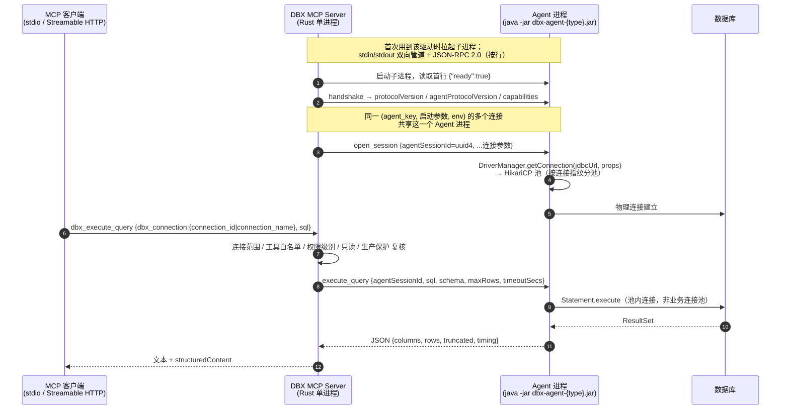

# 调研：DBX 的 Java Agent 如何带动多数据源接入

对象：`t8y2/dbx`（Rust + Tauri 数据库客户端，Apache-2.0）内置的 **Java Agent** 体系，以及它与 DBX MCP Server 的数据源组织方式。
本机对应物：`C:/Users/Nn/.dbx/`（agent 运行时与 MCP 二进制）、`C:/Users/Nn/AppData/Roaming/com.dbx.app/plugins/jdbc/`（通用 JDBC 插件）。

## 0. 先纠正一个前提

**DBX 的 "Java Agent" 不是 JVM 插桩 agent（不是 `-javaagent` / attach / JVMTI），而是 DBX 自己拉起的独立子进程。**
它不进入业务应用进程，也就不会"在运行中的 Java 应用里发现 DataSource Bean"；每个数据源由 DBX 配置（MCP 侧叫 *connection*），Agent 用 DBX 下发的连接参数自己再建一条 JDBC 连接。

硬证据：

- Agent JAR 的清单只有 `Main-Class`，**没有 `Premain-Class` / `Agent-Class` / `Can-Retransform-Classes`**：
  `C:/Users/Nn/.dbx/agents/drivers/dameng/agent.jar!/META-INF/MANIFEST.MF:1-4`（`Main-Class: com.dbx.agent.dameng.DamengAgent`）。
- Agent 源码树里没有 `premain` / `agentmain` / `Instrumentation` / `retransform` 任何一处（对 `agents/common/src/main/java/com/dbx/agent/**` 全量反编译后检索无命中；构建脚本 `agents/build.gradle:49-52` 只设 `archiveBaseName`，无 manifest 注入）。
- MCP 二进制 `C:/Users/Nn/.dbx/bin/dbx-mcp.exe`（Rust，36 MB）内检索不到 `javaagent` / `agentmain` / `Instrumentation`（唯一一次 `premain` 命中落在压缩 blob 内，非代码字符串）。
- 官方定位：*"Each agent runs as a standalone process and communicates with DBX via stdin/stdout JSON-RPC 2.0."* —— https://github.com/t8y2/dbx/blob/main/agents/README.md#L7
- *"Every agent is a standalone JVM process that … Talks to DBX over stdin/stdout JSON-RPC 2.0."* —— https://github.com/t8y2/dbx/blob/main/agents/docs/agent-authoring.md#L7-L15

因此本笔记回答的是"DBX 的 Java Agent 如何把**多个数据源**接进 MCP"，而不是"如何在业务 JVM 里发现 DataSource"。后者在 DBX 里不存在。

## 1. 机制总览



DBX 自己的架构图（同样的意思）：

```
DBX Main Process (Rust/Tauri)
    │ stdin/stdout (JSON-RPC 2.0)
    ▼
agent / java -jar dbx-agent-{type}.jar
    │
    ▼
Native driver / JDBC → Database
```
—— https://github.com/t8y2/dbx/blob/main/agents/README.md#L150-L161

## 2. 七个问题逐条回答

### Q1 接入方式：不是 `-javaagent`，是"父进程拉起子进程 + stdio JSON-RPC"

- 方式：**独立子进程**。Rust 侧用 `stdin/stdout/stderr` 全管道启动：`command.args(...).stdin(Stdio::piped()).stdout(Stdio::piped()).stderr(Stdio::piped())` —— https://github.com/t8y2/dbx/blob/main/crates/dbx-driver-agent/src/agent_driver.rs#L4134-L4135 。Agent 侧就是 `System.in` 逐行读、`System.out` 逐行写 —— https://github.com/t8y2/dbx/blob/main/agents/common/src/main/java/com/dbx/agent/MultiSessionJsonRpcServer.java#L148-L160 。
- 协议自述：*"Agents can be Java JARs, native executables, or script runtimes as long as they speak the DBX stdin/stdout JSON-RPC protocol."* —— https://github.com/t8y2/dbx/blob/main/crates/dbx-driver-agent/src/agent_driver.rs#L2161-L2163
- **字节码增强：无**。目标不是 `javax.sql.DataSource`/`DriverManager`/`HikariCP`/`Druid`/`MyBatis`/`JdbcTemplate` 的插桩；Agent 是把这些库**当普通依赖使用**：`DriverManager.getConnection(...)` —— https://github.com/t8y2/dbx/blob/main/agents/common/src/main/java/com/dbx/agent/AbstractJdbcAgent.java#L654-L655 ，HikariCP 直接 shade 进 Agent JAR —— https://github.com/t8y2/dbx/blob/main/agents/README.md#L90 。
- 运行时要求：Java Agent 需要 **JRE 21 + 对应 Agent 包 + JDBC 驱动**三者齐备，DBX 负责下载/管理 JRE —— https://github.com/t8y2/dbx/blob/main/docs/content/docs/mcp.cn.mdx#L358-L360 、 https://github.com/t8y2/dbx/blob/main/agents/README.md#L69-L71 。本机状态：`C:/Users/Nn/.dbx/agents/state.json:1-30`（`installed_drivers.rabbitmq/vastbase/dameng`，`java_runtime.custom_java_path = C:\Program Files\Java\jdk21.0.8_9\bin\java.exe`）。
- 打包形态：shadow JAR `dbx-agent-<type>.jar`，清单写 `Agent-Label` + `Main-Class` —— https://github.com/t8y2/dbx/blob/main/agents/docs/agent-authoring.md#L148-L160 。本机实例：`C:/Users/Nn/.dbx/agents/drivers/dameng/agent.jar`、`C:/Users/Nn/.dbx/agents/download-cache/driver-dameng-base-0.1.102-.agent.jar.tar.zst`。

### Q2 多数据源的发现与命名：**不发现，靠配置 + 选择器**；标识 = connection_id（UUID）/ name，Agent 侧 = agentSessionId（UUID）

- DBX 的"多数据源"模型是 **connection（连接）**，存于 DBX 存储（`dbx.db`），字段含 `id`/`name`/`db_type`/`driver_profile`/`host`/`port`/`username`/`password`/`database`/`default_schema`/`read_only`/`is_production` —— https://github.com/t8y2/dbx/blob/main/crates/dbx-types/src/models/connection.rs#L155-L177 、 #L321-L325 。
- **枚举方式**：MCP 工具 `dbx_list_connections` 返回当前会话可见的连接；资源 `dbx://connections` 同源 —— https://github.com/t8y2/dbx/blob/main/crates/dbx-mcp/src/server.rs#L54-L57 、 https://github.com/t8y2/dbx/blob/main/docs/content/docs/mcp.cn.mdx#L125-L129 。
- **调用时如何选源**：所有连接型工具都带 `dbx_connection` 选择器（`connection_id` 或 `connection_name`），二者至少给一个，否则 `CONNECTION_NOT_FOUND` —— https://github.com/t8y2/dbx/blob/main/crates/dbx-mcp/src/server.rs#L4224-L4241 、 #L5324-L5341 。**工具名不随数据源变化**，数据源是参数而不是工具前缀。
- **命名规则**：`name` 全局唯一（大小写不敏感）—— https://github.com/t8y2/dbx/blob/main/crates/dbx-mcp/src/server.rs#L4152-L4154 ；`id` 是内部 UUID 串（连接增删改用 `Uuid::new_v4()`）—— https://github.com/t8y2/dbx/blob/main/crates/dbx-mcp/src/server.rs#L4252 。
- **Agent 侧命名**：每个连接在 Agent 进程里对应一个 **逻辑会话**，键 `agentSessionId`，由宿主生成 `uuid::Uuid::new_v4().simple()` —— https://github.com/t8y2/dbx/blob/main/crates/dbx-core/src/connection/mod.rs#L3951 ；Agent 端 `agentSessionId` 缺失即报错 —— https://github.com/t8y2/dbx/blob/main/agents/common/src/main/java/com/dbx/agent/MultiSessionJsonRpcServer.java#L442-L447 。
- **主库/从库/多租户**：DBX 没有"主从"概念，靠**作用域**表达多租户/多库：连接下再挂数据库范围（库 → 连接 → 分组 → 全局 逐级继承，越具体越优先，但连接只读/生产保护/账号权限是硬上限）—— https://github.com/t8y2/dbx/blob/main/docs/content/docs/mcp.cn.mdx#L450-L452 、 #L466 。默认库/schema 取连接配置的 `database` / `default_schema` —— https://github.com/t8y2/dbx/blob/main/crates/dbx-types/src/models/connection.rs#L174-L176 。
- 宿主侧还会用 `DBX_MCP_SCOPE_CONNECTION_ID(S)` / `_CONNECTION_NAME` / `_DATABASE` / `_SCHEMA` 限制会话可见范围 —— https://github.com/t8y2/dbx/blob/main/crates/dbx-mcp/src/server.rs#L1018-L1046 、 https://github.com/t8y2/dbx/blob/main/docs/content/docs/mcp.cn.mdx#L490-L494 。

### Q3 连接与元数据：Agent 自建 Hikari 池；元数据从 `DatabaseMetaData`/方言 SQL 读，缓存在宿主存储

- **连接怎么来**：宿主把连接参数（host/port/database/username/password/url_params/connection_string/jdbc_driver_class/jdbc_driver_paths/证书路径…）下发给 Agent，Agent 用 `DriverManager.getConnection(jdbcUrl, props)` 自己建连 —— https://github.com/t8y2/dbx/blob/main/agents/common/src/main/java/com/dbx/agent/ConnectParams.java （本地反编译同文件在 `C:/Users/Nn/.dbx/agents/drivers/dameng/agent.jar` 的 `com/dbx/agent/ConnectParams.class`）、 https://github.com/t8y2/dbx/blob/main/agents/common/src/main/java/com/dbx/agent/AbstractJdbcAgent.java#L654-L655 。
- **分池指纹**：连接身份 = `agentClass + driverClass + jdbcUrl + host + port + database + username + password + urlParams + connectionString + portExplicit`，取 SHA-256 作池键 —— https://github.com/t8y2/dbx/blob/main/agents/common/src/main/java/com/dbx/agent/AbstractJdbcAgent.java#L913-L925 、 https://github.com/t8y2/dbx/blob/main/agents/common/src/main/java/com/dbx/agent/JdbcConnectionPoolRegistry.java#L286-L292 。
- **池参数（默认值）**：maxPoolSize=8、minIdle=0、connectionTimeout=30s、validationTimeout=5s、idleTimeout=120s、maxLifetime=1800s、retire=60s、**metadataReserve=2**、**globalMaximumPhysicalConnections=32**、maxQuarantinedOperations=32 —— https://github.com/t8y2/dbx/blob/main/agents/common/src/main/java/com/dbx/agent/JdbcConnectionPoolRegistry.java#L43-L52 、 #L728-L808 。全部可用 `dbx.agent.jdbc.pool.*` / `DBX_AGENT_JDBC_POOL_*` 环境变量覆盖 —— 同上 #L730-L806 。
- **不与业务连接池抢占**：**根本没有共享**——Agent 不进业务进程，池是它自己的。但 DBX 在自己内部做了"元数据 vs 业务"隔离：`PoolEntry` 用两个信号量，`workloadPermits = maxPoolSize - metadataReserve`、`leasePermits = maxPoolSize` —— https://github.com/t8y2/dbx/blob/main/agents/common/src/main/java/com/dbx/agent/JdbcConnectionPoolRegistry.java#L896-L897 ；角色枚举 `WORKLOAD / METADATA` —— https://github.com/t8y2/dbx/blob/main/agents/common/src/main/java/com/dbx/agent/JdbcSessionRole.java 。宿主侧也按 session role 分池键 —— https://github.com/t8y2/dbx/blob/main/crates/dbx-core/src/connection/mod.rs#L6197-L6201 。
- **元数据来源**：标准 JDBC 走 `DatabaseMetaData`（`ConfiguredJdbcAgent` / `StandardJdbcMetadata`），PG 系走方言 SQL（`PostgresLikeAgent`），二者共享"生命周期 + 执行 + 分页 + 事务 + DDL 回退"基座 —— https://github.com/t8y2/dbx/blob/main/agents/docs/agent-authoring.md#L115-L124 。Schema 切换靠方言化 `setSchemaSQL`，由 `JdbcSchemaSwitcher` 执行并在语句后复位 —— https://github.com/t8y2/dbx/blob/main/agents/common/src/main/java/com/dbx/agent/AbstractJdbcAgent.java#L175-L180 。
- **元数据缓存（在宿主，不在 Agent）**：键 `object-meta:v1:<connection_id>:<database>` / `object-ddl:v1:...`，落在 DBX 存储；命中 DDL 类语句时失效 —— https://github.com/t8y2/dbx/blob/main/crates/dbx-core/src/query/object_cache.rs#L9-L12 、 #L31-L38 、 #L41-L63 。

### Q4 agent ↔ MCP server 的通道：本地 stdio 管道 + JSON-RPC 2.0（按行），无 socket/HTTP

- **通道形态**：父子进程的 stdin/stdout 管道，一行一个 JSON 对象；stderr 单独收集作诊断尾部 —— https://github.com/t8y2/dbx/blob/main/crates/dbx-driver-agent/src/agent_driver.rs#L2069-L2093 、 #L4231-L4249 。
- **握手**：
  1. 启动：Agent 先打印 `{"ready":true}`，宿主读到才继续；读不到就报错并重试一次 —— https://github.com/t8y2/dbx/blob/main/agents/common/src/main/java/com/dbx/agent/MultiSessionJsonRpcServer.java#L148-L151 、 https://github.com/t8y2/dbx/blob/main/crates/dbx-driver-agent/src/agent_driver.rs#L2093-L2105 、 #L2053-L2062 。
  2. 协议握手：`handshake` 返回 `{protocolVersion, agentProtocolVersion, capabilities}`；宿主记日志 `[agent] handshake complete: protocol=…, agent_protocol=…, capabilities=…`，失败则退回 legacy 协议 —— https://github.com/t8y2/dbx/blob/main/crates/dbx-driver-agent/src/agent_driver.rs#L3700-L3721 、 https://github.com/t8y2/dbx/blob/main/agents/common/src/main/java/com/dbx/agent/AgentProtocol.java#L468-L491 。
  3. 能力协商：当前 v2 默认能力 `connect/test_connection/metadata/query/paged_query/transaction/ddl/multi_session`，另有 `structured_error_v1`、`blob_bind_statements_v1`、`native_job_*`、`exact_metadata_identity_v1` 等 —— 见本机 `C:/Users/Nn/.dbx/agents/drivers/dameng/agent.jar!/agent-protocol-v2.json`（该 JSON 直接打包在 JAR 根目录）。
- **鉴权**：**通道上没有任何 token**——它就是父子进程的私有管道，信任边界 = 进程边界。真正的鉴权在 MCP 对外一侧（见 Q6）。
- **心跳**：**没有独立心跳**。存活靠 RPC 失败即断（`Agent runtime terminated` / `connection lost` / `end of stream`）；Agent 侧只有 60s 一次的维护任务 —— https://github.com/t8y2/dbx/blob/main/agents/common/src/main/java/com/dbx/agent/MultiSessionJsonRpcServer.java#L34 、 https://github.com/t8y2/dbx/blob/main/crates/dbx-driver-agent/src/agent_driver.rs#L4378-L4381 。
- **断线重连**：Agent 侧不重连；宿主侧在 `open_session` 失败时丢弃共享 runtime，下次重新拉进程（`forget_unused_runtime_after_failed_open`）—— https://github.com/t8y2/dbx/blob/main/crates/dbx-driver-agent/src/agent_runtime.rs#L366-L391 。宿主进程重启后 Agent 进程随之重启（JVM 无状态）。
- **取消**：`cancel_session {agentSessionId}` —— https://github.com/t8y2/dbx/blob/main/crates/dbx-driver-agent/src/agent_driver.rs#L421-L429 。

### Q5 执行面：SQL 在 **Agent 自己的池连接** 上执行；只读在**宿主**判定；行数/超时双重限制

- **在哪执行**：Agent 进程内、自己的 HikariCP 池连接上（不是业务应用的连接池）。`executeQuery` → `JdbcExecutor.current().execute(conn, sql, schema, setSchemaSQL, resetSchemaSQL, maxRows, fetchSize, timeoutSecs, …)` —— https://github.com/t8y2/dbx/blob/main/agents/common/src/main/java/com/dbx/agent/AbstractJdbcAgent.java#L213-L218 。执行用 `Statement.execute`（不区分 SELECT/其他），并对 `BEGIN/COMMIT/ROLLBACK` 做专门处理 —— https://github.com/t8y2/dbx/blob/main/agents/docs/agent-authoring.md#L67-L80 。
- **只读**：**Agent 侧完全不识别只读**（对 `readOnly|readonly|read_only` 检索 `agents/common` 源码零命中）。只读由宿主 Rust 侧判定：`SqlRisk{ReadOnly, Write, Ddl, Transaction}` —— https://github.com/t8y2/dbx/blob/main/crates/dbx-sql-core/src/sql_risk.rs#L17-L28 ；权限级别 `None < Read < Write < Full` —— https://github.com/t8y2/dbx/blob/main/crates/dbx-core/src/ai/mcp_access.rs#L64-L71 ；拒绝码 `MCP_READ_ONLY` / `CONNECTION_READ_ONLY` / `PRODUCTION_WRITE_BLOCKED` / `TOOL_BLOCKED` / `SCOPE_OUT_OF_POLICY` —— https://github.com/t8y2/dbx/blob/main/crates/dbx-mcp/src/server.rs#L1131-L1172 。
- **超时**：Agent 用 `statement.setQueryTimeout(timeoutSecs)` —— https://github.com/t8y2/dbx/blob/main/agents/common/src/main/java/com/dbx/agent/JdbcExecutor.java#L71 ；宿主还有 RPC 级超时（`Agent RPC call timed out at …`）与连接级超时。
- **行数限制**：Agent 侧 `stmt.setMaxRows(...)` + 读满即置 `truncated=true` —— https://github.com/t8y2/dbx/blob/main/agents/common/src/main/java/com/dbx/agent/JdbcExecutor.java#L272 、 #L362-L365 ，Agent 默认 `DEFAULT_MAX_ROWS=10000` —— 同上 #L27 ；宿主/MCP 侧再夹一次：`max_rows` 取值 1–1000、默认 100、**越界夹取不报错** —— https://github.com/t8y2/dbx/blob/main/docs/content/docs/mcp.cn.mdx#L191 。分页另有 `execute_query_page` / `fetch_query_page` / `close_query_session` 三段式游标 —— 见 `C:/Users/Nn/.dbx/agents/drivers/dameng/agent.jar!/agent-protocol-v2.json` 的 `commonMethods`。
- **写语句是否被拦截**：**在宿主拦截，不在 Agent 拦截**。高危 SQL / 破坏性操作走"人工确认"流程：确认时展示工具、目标与操作内容，批准只对本次调用生效，批准后还要重新校验权限 —— https://github.com/t8y2/dbx/blob/main/docs/content/docs/mcp.cn.mdx#L454-L458 。批处理里只要含一条写/DDL，整次调用在只读策略下失败 —— 同上 #L251 。
- **结果序列化**：`QueryResult{columns, columnTypes, rows, executionTimeMs, truncated}` 的 JSON；LOB/大字段可延迟读取并分块取（`read_large_value_chunk` / `release_large_value`）—— https://github.com/t8y2/dbx/blob/main/agents/common/src/main/java/com/dbx/agent/JdbcExecutor.java#L331-L370 、 `C:/Users/Nn/.dbx/agents/drivers/dameng/agent.jar!/agent-protocol-v2.json`（`blob_bind_statements_v1` / `read_large_value_chunk`）。

### Q6 安全边界：Agent 通道无鉴权（进程边界即信任边界），鉴权与只读全部在宿主侧

- **谁能连 Agent**：只有父进程（管道私有）。Agent 侧无 token、无来源校验。
- **谁能连 MCP Server**：stdio 形态靠进程归属；HTTP 形态用 **Bearer Token**（常量时间比较）+ Host/Origin allowlist —— https://github.com/t8y2/dbx/blob/main/crates/dbx-mcp/src/http_auth.rs#L14-L25 、 #L105-L118 ；Desktop 默认只监听 `127.0.0.1:5225/mcp` 并生成 Token —— https://github.com/t8y2/dbx/blob/main/docs/content/docs/mcp.cn.mdx#L305-L307 。Web 模式用 `DBX_WEB_MCP_TOKEN` / `DBX_WEB_MCP_TOKEN_FILE` + `DBX_WEB_MCP_ALLOWED_HOSTS/ORIGINS` —— 同上 #L370-L386 。
- **默认是否只读**：默认权限级别是 **Read**（`default_access: McpAccessLevel::Read`）—— https://github.com/t8y2/dbx/blob/main/crates/dbx-core/src/ai/mcp_access.rs#L306 ；并且可以用 `DBX_MCP_ALLOW_WRITES=0` 在本次运行强制只读（该变量**只能收紧不能放宽**）—— https://github.com/t8y2/dbx/blob/main/docs/content/docs/mcp.cn.mdx#L471-L471 。注意这条是 DBX 侧"收紧"开关，DBX 明确**不允许**用 `DBX_MCP_ALLOW_WRITES=1` 放宽中央策略。
- **白名单/黑名单**：工具有 allowlist（服务端每次调用强制，不只是客户端展示偏好）—— https://github.com/t8y2/dbx/blob/main/docs/content/docs/mcp.cn.mdx#L406-L406 ；连接有 allowlist（连接/分组/库三级可见性）—— 同上 #L440-L442 ；SQL 有风险分级（read-only / write / DDL / transaction）—— https://github.com/t8y2/dbx/blob/main/crates/dbx-sql-core/src/sql_risk.rs#L17-L28 ；Redis 命令另有安全分类 `REDIS_COMMAND_BLOCKED` —— https://github.com/t8y2/dbx/blob/main/crates/dbx-mcp/src/server.rs#L3762-L3780 。
- **敏感列脱敏**：**未找到**。全库与 Agent 源码中未见列级脱敏/掩码机制；只有"连接备注不得存密码"的提示 —— https://github.com/t8y2/dbx/blob/main/docs/content/docs/mcp.cn.mdx#L187-L187 。
- **审计**：有 **MCP 调用记录**，字段含时间、接入方式（stdio/HTTP）、客户端名与版本、工具、目标连接/库、判定级别、是否经确认、耗时、请求/响应摘要、成功/失败原因 —— https://github.com/t8y2/dbx/blob/main/docs/content/docs/mcp.cn.mdx#L462-L464 ；写入路径另有调用历史落库（`connection_id / sql / mcp_tool_name / executed_at`）—— https://github.com/t8y2/dbx/blob/main/crates/dbx-mcp/src/server.rs#L1601-L1650 。
- **凭据不外泄**：连接凭据由宿主持有，插件工具场景下"凭据由宿主从保存的连接生成 lifecycle 注入，永不经过模型或客户端" —— https://github.com/t8y2/dbx/blob/main/docs/content/docs/mcp.cn.mdx#L200-L200 。

### Q7 支持的数据源类型与限制：Agent 一族 + 原生驱动 + 通用 JDBC 插件；动态新增数据源**不需要重启**

- **Agent 家族**（本机只装了 3 个）：Java（JVM）Agent 覆盖 access/dameng/hbase 系/DB2/Hive/Trino/Snowflake/SAP HANA/Teradata/Vertica/Firebird/Exasol/Kingbase…；原生（Go/Rust）Agent 覆盖 cassandra/duckdb/hive-go/iotdb/oracle-go/kingbase-go/vastbase-go/tdengine/xugu/rabbitmq/rocketmq/zookeeper/etcd 等，**不需要 JRE** —— https://github.com/t8y2/dbx/blob/main/agents/README.md#L9-L67 、 #L95-L97 。本机：`C:/Users/Nn/.dbx/agents/state.json`（rabbitmq / vastbase / dameng）。
- **DBX 的明确建议**：能用成熟原生驱动就别用 Java/JDBC Agent（省 JVM 常驻内存与启动时间）—— https://github.com/t8y2/dbx/blob/main/agents/README.md#L95-L95 。
- **通用 JDBC 兜底**：独立 sidecar 插件 `plugins/jdbc`，manifest 声明 `protocol_version: 1`、`kind: external`、`database_type: jdbc` —— 本机 `C:/Users/Nn/AppData/Roaming/com.dbx.app/plugins/jdbc/manifest.json:1-16`（上游同文件 https://github.com/t8y2/dbx/blob/main/plugins/jdbc/manifest.json）。它用 Maven resolver 拉驱动（`bin/dbx-maven-resolver`），并支持 JDBCX（`io.github.jdbcx.WrappedDriver`）作为一等 profile；JDBCX 默认只放开 `help/var/version` 扩展，`shell/script/web/mcp` 等高权限扩展必须逐连接显式开启 —— https://github.com/t8y2/dbx/blob/main/plugins/jdbc/README.md#L38-L58 。同一插件进程也按 `(runtime_key, env.vars)` 复用，多连接各持一个逻辑会话（UUID v4）—— https://github.com/t8y2/dbx/blob/main/crates/dbx-plugin-runtime/src/plugins/jdbc_sessions.rs#L32-L80 。
- **连接池实现限制**：Agent 内置 HikariCP 7.1.0（shade 进 JAR），可用 `DBX_AGENT_JDBC_POOL_ENABLED=false` 回退到"一逻辑会话一物理连接"的旧行为 —— https://github.com/t8y2/dbx/blob/main/agents/README.md#L90-L91 、 https://github.com/t8y2/dbx/blob/main/agents/build.gradle#L62-L66 。**对业务侧连接池无要求**（因为不共享）。
- **动态新增数据源要不要重启**：**不要**。MCP 工具 `dbx_add_connection` / `dbx_duplicate_connection` / `dbx_remove_connection` 直接改 DBX 存储，下一次调用按需拉起对应 Agent 进程 —— https://github.com/t8y2/dbx/blob/main/crates/dbx-mcp/src/server.rs#L4148-L4182 、 #L4248-L4256 、 #L4309-L4362 。
- **进程复用粒度**：同一 driver 的多个连接**共享一个 Agent 进程**，进程指纹 = `agent_key + program + args + working_dir + env`（env 入指纹是为了隔离 Oracle 的 `NLS_LANG` 等进程级设置）—— https://github.com/t8y2/dbx/blob/main/crates/dbx-driver-agent/src/agent_runtime.rs#L413-L425 。同一进程内并发会话上限 **256**、请求线程池 **64** —— https://github.com/t8y2/dbx/blob/main/agents/common/src/main/java/com/dbx/agent/MultiSessionJsonRpcServer.java#L31-L33 、 #L247-L252 。若 Agent 不支持 `multi_session` 协议 v2，宿主回退为"每连接一个专属进程" —— https://github.com/t8y2/dbx/blob/main/crates/dbx-core/src/connection/mod.rs#L4000-L4004 、 https://github.com/t8y2/dbx/blob/main/crates/dbx-driver-agent/src/agent_driver.rs#L151-L161 。

## 3. 插件/连接类型如何声明连接元数据与能力

DBX 把"数据源长什么样"拆成**三层彼此独立的声明**，各自落盘位置不同。

### 3.1 连接类型描述符 `plugins/connection-types/<db>.yaml`（上游共 90 个文件）

这是**数据源元数据与能力位的主声明处**，Rust 侧编译期转成 `database_manifest.json`，运行时解析为 `DatabaseManifestEntry`。以达梦为例，逐行字段（原文 https://github.com/t8y2/dbx/blob/main/plugins/connection-types/dameng.yaml#L1-L42 ）：

```yaml
schemaVersion: 1
order: 260
dbType: dameng
compareModes: [schema, data]
transferSupportLevel: family-compatible
transferObjectFamily: oracle
rustVariant: Dameng
label: 达梦 DM8
dialect: Dameng
runtimeMode: agent
mcpMode: bridge
agentKey: dameng
driverStoreVisible: true
driverStoreOrder: 1
singleConnectionPool: true
metadataConnectionScoped: false
skipTcpProbe: true
defaultPort: 5236
traits:
  schemaAware: true
  singleDatabase: true
  clearableQuerySchema: true
  fetchFirst: true
  diagramSql: true
supportLevel: operate
capabilities:
  queryExecution: true
  metadataBrowse: true
  objectBrowser: true
  objectSource: true
  schemaSearch: true
  diagram: true
  tableDataEdit: true
  tableStructureEdit: true
  tableImport: true
  dataTransfer: true
  sqlFileExecution: true
  databaseCreate: false
  fieldLineage: true
  sqlExplain: true
  userAdmin: false
  driverManagement: true
```

字段语义（逐条有据）：

- `runtimeMode` 决定执行路径，枚举**只有 4 个值**：`Native` / `File` / `Agent` / `External` —— https://github.com/t8y2/dbx/blob/main/crates/dbx-types/src/database_manifest.rs#L16-L21 。`agent`=走 Agent 子进程；`external`=走外部插件（本机 JDBC 插件即此类：`runtimeMode: external`、`mcpMode: bridge`、`formKind: jdbc`、`supportLevel: browse`）—— https://github.com/t8y2/dbx/blob/main/plugins/connection-types/jdbc.yaml#L1-L16 。
- `agentKey` = Agent 包键（= Agent 模块名），这是**数据源 → Agent 二进制**的唯一映射字段 —— https://github.com/t8y2/dbx/blob/main/crates/dbx-types/src/database_manifest.rs#L130 、 https://github.com/t8y2/dbx/blob/main/crates/dbx-driver-agent/src/agent_catalog.rs#L6-L11 。
- `driverProfiles[]` 让同一数据库有多个 Agent 包/版本变体，字段为 `{profile, agentKey, packageKey, label, storeVisible, storeOrder}` —— Oracle 的 `oci` profile 指向 `agentKey: oracle-oci`（https://github.com/t8y2/dbx/blob/main/plugins/connection-types/oracle.yaml#L15-L30 ）、H2 的 `h2-legacy/h2-v1/h2-v2/h2-v3/h2-custom` 五个 profile 共用 `agentKey: h2`（https://github.com/t8y2/dbx/blob/main/plugins/connection-types/h2.yaml#L14-L35 ）。
- `capabilities{}` 是**能力位**（是否支持 DML/DDL/对象浏览/表数据编辑/建库/字段血缘/解释计划等）。Rust 侧枚举为 `DatabaseCapability{QueryExecution, MetadataBrowse, ObjectBrowser, ObjectSource, SchemaSearch, TableDataEdit, SqlFileExecution}`，未显式声明的按 `supportLevel` 推导默认值 —— https://github.com/t8y2/dbx/blob/main/crates/dbx-types/src/database_manifest.rs#L100-L114 、 #L153-L180 。
- `traits{}` 是行为特征：`schemaAware` / `singleDatabase` / `treeSchema` / `databaseObjectTree` / `clearableQuerySchema` / `fetchFirst` / `diagramSql` —— https://github.com/t8y2/dbx/blob/main/plugins/connection-types/dameng.yaml#L19-L24 、 https://github.com/t8y2/dbx/blob/main/plugins/connection-types/jdbc.yaml#L12-L15 。
- `singleConnectionPool` / `metadataConnectionScoped` / `skipTcpProbe` 三个布尔直接驱动宿主的连接池与探测行为，且 `is_agent_type(db_type)` 恒为 `skipTcpProbe=true` —— https://github.com/t8y2/dbx/blob/main/crates/dbx-driver-agent/src/database_capabilities.rs#L14-L26 、 #L66-L80 。
- 这份 YAML 由 `crates/dbx-types/build.rs` 在编译期生成 `database_manifest.json` —— https://github.com/t8y2/dbx/blob/main/crates/dbx-types/build.rs#L16-L18 、 #L67-L72 ，运行时读取入口 https://github.com/t8y2/dbx/blob/main/crates/dbx-types/src/database_manifest.rs#L186-L198 。

### 3.2 插件清单 `plugins/<id>/manifest.json`

本机 JDBC 插件的清单**只有 6 个顶层字段 + 一个 drivers 数组**：

```json
{
  "id": "jdbc",
  "name": "DBX JDBC Plugin",
  "version": "0.1.52",
  "protocol_version": 1,
  "description": "Adds optional JDBC driver support to DBX.",
  "executable": "bin/dbx-jdbc-plugin",
  "drivers": [ { "id": "jdbc", "label": "JDBC", "kind": "external", "database_type": "jdbc" } ]
}
```
（上游 https://github.com/t8y2/dbx/blob/main/plugins/jdbc/manifest.json#L1-L16 ；本机 `C:/Users/Nn/AppData/Roaming/com.dbx.app/plugins/jdbc/manifest.json:1-16`，本机版本 `0.1.51`）

**清单里没有驱动坐标、没有连接参数 schema、没有能力位、没有权限级别**：`drivers[]` 的字段只有 `{id, label, kind, database_type}`（Rust 侧 `PluginDriverManifest`）—— https://github.com/t8y2/dbx/blob/main/crates/dbx-plugin-runtime/src/plugins/manifest.rs#L210-L218 。JDBC 插件用的是**旧版 v0 清单**，宿主仍兼容读取（`protocol_version` / `executable` / `drivers` 被显式标注为 legacy v0 字段）—— 同上 #L131-L140 。

宿主侧新版清单 `PluginManifest` 的完整字段名：`$schema`、`manifest_version`、`id`、`name`、`icon`、`version`、`publisher`、`description`、`source`、`homepage`、`engines`、`permissions[]`、`entrypoints`、`contributions[]`、`localizations`，外加 v0 兼容的 `protocol_version`、`executable`、`drivers[]` —— 同上 #L100-L140 。

### 3.3 插件的连接参数 schema 与 MCP 能力位在哪

`contributions[]` 是枚举：`connection-provider` / `workbench` / `filesystem-provider` / `context-menu` / `result-view` / `command` / `menus` / `mcp` —— https://github.com/t8y2/dbx/blob/main/crates/dbx-plugin-runtime/src/plugins/manifest.rs#L274-L285 。

- **连接参数 schema = `fields[]`**：`PluginConnectionProviderContribution` 字段为 `id`、`label`、`icon`、`database_type`、`description`、`fields[]`、`workbench`、`filesystem_provider`、`capabilities[]`、`actions[]`、`proxy_route`；单个字段 `PluginFormFieldDefinition{key, label, type, description, placeholder, required, default, …}`，`key` 就是 host/port/username/password/ssl 这类字段名 —— 同上 #L709-L736 、 #L414-L426 。连接能力位枚举只有 `test` / `connect` / `disconnect` 三项 —— 同上 #L744-L750 。
- **MCP 能力位**：`PluginMcpContribution` 字段为 `id`、`description`、`ai_tools`（默认 true）、`external_tools`（默认 false，置 true 才暴露到 dbx MCP server）、`toolsets[]`、`tools{}`（按工具名声明 `{toolset, access}`）、可选子作用域 —— 同上 #L319-L344 。

### 3.4 权限级别如何映射到连接

- 插件作者只能声明**每个工具的 access 起点**：`PluginMcpAccess{Read, Write, Full}` —— https://github.com/t8y2/dbx/blob/main/crates/dbx-plugin-runtime/src/plugins/manifest.rs#L381-L395 。
- 宿主统一级别是 `McpAccessLevel{None < Read < Write < Full}`，旧的 `(read_only, allow_dangerous_sql)` 二元组映射为 `Read` / `Full` —— https://github.com/t8y2/dbx/blob/main/crates/dbx-core/src/ai/mcp_access.rs#L64-L93 。
- 生效级别按 **库 → 连接 → 分组 → 全局** 逐级回退取最具体者；连接只读、生产保护、数据库账号权限、MCP 连接 allowlist 是**任何作用域都越不过的硬上限** —— https://github.com/t8y2/dbx/blob/main/docs/content/docs/mcp.cn.mdx#L450-L452 、 #L466 ；`DBX_MCP_ALLOW_WRITES=0` 只能收紧不能放宽 —— 同文件 #L471 ；未配置时全局默认是 `Read` —— https://github.com/t8y2/dbx/blob/main/crates/dbx-core/src/ai/mcp_access.rs#L306 。

## 4. 核心 ⇄ agent 的 RPC 协议与生命周期全貌

### 4.1 协议文件与握手

- 协议是**数据文件**（随 agent jar 一起打包）：`agents/common/src/main/resources/agent-protocol-v1.json` / `agent-protocol-v2.json`；本机 jar 根目录直接可见 `agent-protocol-v1.json` / `agent-protocol-v2.json`（`C:/Users/Nn/.dbx/agents/drivers/dameng/agent.jar!/agent-protocol-v2.json`）。
- 握手：宿主 → agent `{"method":"handshake","params":{"appVersion":…,"supportedProtocolVersions":[2]}}`（`AGENT_PROTOCOL_VERSION = 2`）—— https://github.com/t8y2/dbx/blob/main/crates/dbx-driver-agent/src/agent_driver.rs#L1142 、 #L3812-L3817 ；agent → 宿主返回 `{protocolVersion, agentProtocolVersion, capabilities}` —— https://github.com/t8y2/dbx/blob/main/agents/common/src/main/resources/agent-protocol-v2.json#L4 。降级策略：agent 不认识 `handshake`（`Unknown method: handshake` 等）时退回 legacy 协议 —— https://github.com/t8y2/dbx/blob/main/crates/dbx-driver-agent/src/agent_driver.rs#L3819-L3823 、 #L3700-L3721 。
- 能力位全集与默认 SQL 能力集：https://github.com/t8y2/dbx/blob/main/agents/common/src/main/resources/agent-protocol-v2.json#L5-L7 —— `allCapabilities` 40 项（含 `multi_session`、`structured_error_v1`、`blob_bind_statements_v1`、`exact_metadata_identity_v1`、`native_job_*`、`zookeeper_endpoint_routes` 等）；`capabilities` 默认 8 项 `connect/test_connection/metadata/query/paged_query/transaction/ddl/multi_session`；`defaultSqlCapabilities` 再加 `structured_error_v1`。

### 4.2 方法清单（`commonMethods`，43 个）

`handshake`、`connect`、`open_session`、`close_session`、`validate_session`、`cancel_session`、`test_connection`、`validate_connection`、`connection_info`、`list_databases`、`list_schemas`、`list_tables`、`list_objects`、`list_data_types`、`completion_assistant_search_v1`、`get_object_source`、`get_table_ddl`、`get_columns`、`list_indexes`、`list_foreign_keys`、`list_triggers`、`list_constraints`、`list_partitions`、`list_subpartitions`、`get_table_partition_status`、`get_table_partitioning`、`execute_query`、`execute_query_page`、`fetch_query_page`、`close_query_session`、`read_large_value_chunk`、`release_large_value`、`start_table_read`、`fetch_table_read_page`、`close_table_read_session`、`get_explain_info`、`execute_batch`、`execute_transaction`、`begin_manual_transaction`、`commit_manual_transaction`、`rollback_manual_transaction`、`disconnect`、`shutdown` —— https://github.com/t8y2/dbx/blob/main/agents/common/src/main/resources/agent-protocol-v2.json#L51-L97 。

另有三组专用方法：native job（`prepare_legacy_job` / `commit_legacy_job` / `rollback_legacy_job` / `legacy_job_status`）、native job session（`open_native_job_session` / `close_native_job_session`）、MongoDB legacy 方法集与 KV 方法集 —— 同文件 #L8-L9 、 #L87-L96 。会话字段名固定：`sessionField = agentSessionId`、`cursorSessionField = sessionId` —— 同文件 #L98-L99 。

### 4.3 生命周期

- **会话标识**：`agentSessionId` 由宿主生成（uuid v4 simple 串）—— https://github.com/t8y2/dbx/blob/main/crates/dbx-core/src/connection/mod.rs#L3951 ；agent 端缺失即抛 `agentSessionId is required` —— https://github.com/t8y2/dbx/blob/main/agents/common/src/main/java/com/dbx/agent/MultiSessionJsonRpcServer.java#L442-L447 。
- **会话表**：`sessions` 为 `ConcurrentHashMap`，上限 `MAX_SESSIONS = 256`（超出报 backpressure）—— 同上 #L31 、 #L246-L252 ；请求线程池 `MAX_REQUEST_THREADS = 64`、清理线程池 `MAX_CLEANUP_THREADS = 16` —— 同上 #L32-L33 ；无 `agentSessionId` 的请求落到 legacy 会话 `"__legacy__"`（`connect`/`disconnect` 也走它）—— 同上 #L30 、 #L228-L237 。
- **每个会话一个 Agent 实例**：`open_session` 时 `agentFactory.get()` 新建一个 `DatabaseAgent`，并把进程级共享的 `JdbcConnectionPoolRegistry` 挂上去 —— 同上 #L253-L266 。
- **超时**：RPC 默认 30s（`RPC_TIMEOUT_SECS`）、启动 15s（`STARTUP_TIMEOUT_SECS`），握手超时取 `min(启动 deadline, RPC_TIMEOUT)` —— https://github.com/t8y2/dbx/blob/main/crates/dbx-driver-agent/src/agent_driver.rs#L1143-L1144 、 #L136-L138 ；语句超时由 agent `statement.setQueryTimeout` 执行 —— https://github.com/t8y2/dbx/blob/main/agents/common/src/main/java/com/dbx/agent/JdbcExecutor.java#L71 。
- **取消**：`cancel_session {agentSessionId}`，独立写 stdin 并**保持 stdin 打开**直到取消回执到达（EOF 会让 agent 提前退出）—— https://github.com/t8y2/dbx/blob/main/crates/dbx-driver-agent/src/agent_driver.rs#L421-L429 、 #L2476-L2494 。
- **错误**：结构化错误 `data{category, retryable, sessionDisposition}`，`category` 取 `timeout` / `sql` / `connection`，`sessionDisposition` 取 `keep` / `quarantine`（超时或连接错误且非 connect 阶段 → quarantine）—— https://github.com/t8y2/dbx/blob/main/agents/common/src/main/java/com/dbx/agent/AgentRpcError.java#L90-L92 、 #L138-L148 。宿主把这类错误翻译成统一错误码：`DBX-JDBC-1001/1002/2001/2002/2003/3001/3002/4001/5001/5002/9001`、`DBX-TXN-1001…1010`、`DBX-PLDEBUG-1001` —— https://github.com/t8y2/dbx/blob/main/crates/dbx-driver-agent/src/backend_error.rs#L528-L699 。
- **agent 退出码语义**：**没有专用退出码契约**；宿主只把退出状态拼进错误消息（`agent process exited with exit status: 1`）并附 stderr 尾部 —— https://github.com/t8y2/dbx/blob/main/crates/dbx-driver-agent/src/agent_driver.rs#L4287-L4327 、 #L5201-L5213 。启动阶段未发 `{"ready":true}` 就退出 → 报错并**重试一次** —— 同上 #L2053-L2062 、 #L2093-L2114 。
- **会话回收（agent 侧）**：`close_session` 移除会话并 `quarantineAndClose`；维护线程每 60s 跑一次 `expireIdleResources`（空闲资源过期）—— https://github.com/t8y2/dbx/blob/main/agents/common/src/main/java/com/dbx/agent/MultiSessionJsonRpcServer.java#L34 、 #L275-L287 、 #L337-L356 、 #L564 。
- **会话回收（宿主侧）**：会话计数归零即把共享 runtime 从 map 里摘掉 —— https://github.com/t8y2/dbx/blob/main/crates/dbx-driver-agent/src/agent_runtime.rs#L366-L391 ；另有 `stop_daemons` / `stop_daemon_by_key` / `restart_daemon_by_key` —— 同文件 #L85-L114 。
- **进程复用与回收条件**：共享 runtime 键 = `agent_key + program + args + working_dir + env`（env 入指纹是为隔离 Oracle `NLS_LANG` 等进程级设置）—— 同文件 #L413-L425 ；runtime 用 `OnceCell` + 会话计数管理，失败即从 map 移除后重建 —— 同文件 #L325-L356 、 #L394-L411 ；**agent 不支持 multi_session v2 时退回"每连接一个专属进程"** —— https://github.com/t8y2/dbx/blob/main/crates/dbx-core/src/connection/mod.rs#L4000-L4004 、 https://github.com/t8y2/dbx/blob/main/crates/dbx-driver-agent/src/agent_driver.rs#L151-L161 。

## 5. 驱动与类加载隔离

### 5.1 驱动的三种来源

1. **Bundled**：驱动作为 Gradle 依赖 shade 进 agent jar，不需要额外清单标记 —— https://github.com/t8y2/dbx/blob/main/agents/docs/agent-authoring.md#L129-L143 。
2. **External**：驱动 jar 放模块 `libs/`（`fileTree(dir: 'libs', include: ['*.jar'])`），清单额外写 `Agent-External-Driver: true`；发布工作流据此在 `agent-registry.json` 写 `external_driver_required: true` —— https://github.com/t8y2/dbx/blob/main/agents/docs/agent-authoring.md#L145-L160 、 https://github.com/t8y2/dbx/blob/main/.github/workflows/agents-release.yml#L1579 、 #L1478 。
3. **用户自带**（JDBC 插件场景）：连接里填 `jdbc_driver_paths` / `jdbc_driver_class`，运行时用 `URLClassLoader` 现场加载。

### 5.2 Agent 侧加载策略

```java
if (driverPaths != null && !driverPaths.isEmpty()) {
    URLClassLoader loader = new URLClassLoader(urls, getClass().getClassLoader());
    Driver driver = (Driver) Class.forName(driverClass, true, loader).getDeclaredConstructor().newInstance();
    DriverManager.registerDriver(new DriverShim(driver));
} else {
    Class.forName(driverClass);
}
```
—— https://github.com/t8y2/dbx/blob/main/agents/common/src/main/java/com/dbx/agent/AbstractJdbcAgent.java#L150-L167

要点：**父子委派（parent-first）**，`URLClassLoader` 的 parent 是 agent 自身 classloader（因此 agent 内 shade 的 `common` 与 HikariCP 优先命中）；驱动实例通过 `DriverShim` 包装后再注册到 `DriverManager`（避免驱动自注册时丢失）—— 同上 #L169-L172 。

### 5.3 JDBC 插件侧的加载与冲突处理

- **一个插件进程只服务一个驱动**：`registerDrivers` 维护 `registeredDriverKey`，换驱动先 `closeSharedConnection()` 再重建；已注册同名驱动时直接复用（legacy 别名走 `LegacyJdbcDriverClass.load`）—— https://github.com/t8y2/dbx/blob/main/plugins/jdbc/src/main/java/app/dbx/jdbc/DbxJdbcPlugin.java#L1106-L1128 。
- **类加载**：`new URLClassLoader(urls, DbxJdbcPlugin.class.getClassLoader())` 并设为线程 context classloader；随后 `ServiceLoader.load(Driver.class, loader)` 自动发现驱动，一个都没发现且给了 paths 才报错 `"No JDBC driver was discovered. Enter the driver class name for this JAR."` —— 同上 #L1130-L1171 。
- **多驱动共存**：同一进程内**不允许**切换驱动 —— 同上 #L1108-L1110 （`"JDBC logical sessions require the same selected driver"`）；要并存只能起多个插件进程（宿主侧按 `(runtime_key, env.vars)` 复用/新建）—— https://github.com/t8y2/dbx/blob/main/crates/dbx-plugin-runtime/src/plugins/jdbc_sessions.rs#L32-L80 。
- **驱动坐标解析**：插件自带 `bin/dbx-maven-resolver`（main class `app.dbx.jdbc.maven.DbxMavenResolver`），用 Maven Resolver 解析依赖，本地仓库默认 `~/.dbx/maven` —— https://github.com/t8y2/dbx/blob/main/plugins/jdbc/src/main/java/app/dbx/jdbc/maven/DbxMavenResolver.java#L29-L78 、 #L138-L151 、 本机 `C:/Users/Nn/AppData/Roaming/com.dbx.app/plugins/jdbc/maven-cache/`（本机已存在的 Maven 缓存目录）。
- **插件自己的协议**：插件进程对宿主暴露 `jdbcSessionProtocol` 探测方法，返回 `{version: 2, capabilities: [native_job_legacy_v1, native_job_session_v1, native_job_legacy_ob_v1, exact_metadata_identity_v1]}`；宿主不认这个版本就拒绝并提示升级 —— https://github.com/t8y2/dbx/blob/main/plugins/jdbc/src/main/java/app/dbx/jdbc/DbxJdbcPlugin.java#L704-L709 、 https://github.com/t8y2/dbx/blob/main/crates/dbx-plugin-runtime/src/plugins/jdbc_sessions.rs#L62-L72 。

### 5.4 什么时候才启用 JVM 侧

- **DBX 的明确取舍**：*"For new agents, prefer a native (Go or Rust) driver over a Java/JDBC agent whenever a mature, license-compatible native driver is available."* 理由是原生 agent 单文件、无需 JRE，省掉 JVM 常驻内存与启动时间 —— https://github.com/t8y2/dbx/blob/main/agents/README.md#L95-L97 。
- **判定落在 `runtimeMode`**：`native`（原生驱动） / `file`（本地文件库） / `agent`（Java Agent 子进程） / `external`（外部插件） —— https://github.com/t8y2/dbx/blob/main/crates/dbx-types/src/database_manifest.rs#L16-L21 ；达梦这类国产库走 `agent` —— https://github.com/t8y2/dbx/blob/main/plugins/connection-types/dameng.yaml#L10-L12 ，通用 JDBC 走 `external` —— https://github.com/t8y2/dbx/blob/main/plugins/connection-types/jdbc.yaml#L6-L11 。
- **能力上还要有 Java 版驱动**：JDBC Agent 库需要 JRE 21 + Agent 包 + JDBC 驱动三者齐备 —— https://github.com/t8y2/dbx/blob/main/docs/content/docs/mcp.cn.mdx#L358-L360 。

## 6. 新增一个数据源要交付什么（目录级清单）

以新增一种数据库 `exampledb` 为例，按仓库实际结构：

| # | 交付物 | 位置 / 证据 |
|---|---|---|
| 1 | Agent 模块：Gradle 模块 + 入口类 + 测试 | `agents/drivers/exampledb/build.gradle`、`agents/drivers/exampledb/src/main/java/com/dbx/agent/exampledb/ExampledbAgent.java`；基类选 `ConfiguredJdbcAgent` / `PostgresLikeAgent` / `AbstractJdbcAgent` —— https://github.com/t8y2/dbx/blob/main/agents/docs/agent-authoring.md#L115-L124 |
| 2 | Agent 必备能力（方言元数据） | 必须实现：`connect`、`testConnection`、`listDatabases`、`listSchemas`、`listTables`、`getColumns`、`listIndexes`、`listForeignKeys`、`listTriggers`、`executeQuery`、`disconnect`、`getConnection`；未连接时抛 `IllegalStateException("Not connected")` —— https://github.com/t8y2/dbx/blob/main/agents/docs/agent-authoring.md#L19-L37 |
| 3 | 注册进 Gradle | `agents/settings.gradle` 的 `driverModules` 数组加名字 —— https://github.com/t8y2/dbx/blob/main/agents/settings.gradle#L4-L16 |
| 4 | 版本号 | `agents/versions.json` 加 `"exampledb": "0.1.0"`（CI 会自动 bump，不手改）—— https://github.com/t8y2/dbx/blob/main/agents/docs/agent-authoring.md#L165-L170 、 https://github.com/t8y2/dbx/blob/main/agents/README.md#L141-L141 |
| 5 | JAR 清单 | `Main-Class` + `Agent-Label`（外置驱动再加 `Agent-External-Driver: true`）—— https://github.com/t8y2/dbx/blob/main/agents/docs/agent-authoring.md#L145-L160 、 #L172-L173 |
| 6 | 构建产物校验 | `agents/scripts/validate_agent_jars.py` 会校验 JAR 内有 `Main-Class` 且类文件存在、有 `Agent-Label` —— https://github.com/t8y2/dbx/blob/main/agents/scripts/validate_agent_jars.py#L24-L43 |
| 7 | 连接类型描述符 | `plugins/connection-types/exampledb.yaml`，字段清单见 §3.1（`dbType`、`label`、`dialect`、`runtimeMode`、`mcpMode`、`agentKey`、`driverStoreVisible`、`supportLevel`、`capabilities{}`、`traits{}`…）—— https://github.com/t8y2/dbx/blob/main/plugins/connection-types/dameng.yaml#L1-L42 |
| 8 | Rust 侧类型枚举 | `crates/dbx-types` 的 `DatabaseType` 变体 + `rustVariant`（描述符里的 `rustVariant` 与之对应）—— https://github.com/t8y2/dbx/blob/main/crates/dbx-types/src/database_manifest.rs#L116-L152 |
| 9 | 分发登记 | CI 生成 `agent-registry.json`：`{version, label, min_app_version, jre, external_driver_required, jar:{url, sha256, size}}`，原生 agent 另有 `native{platforms{...}}` —— https://github.com/t8y2/dbx/blob/main/.github/workflows/agents-release.yml#L1444-L1500 、 #L1527-L1560 |
| 10 | 行为测试 | 至少一个执行路径回归测试；有内嵌库用 `JdbcExecutionBehaviorTest` + `JdbcMetadataBehaviorTest`，否则用 `JdbcFakeExecutionBehaviorTest` —— https://github.com/t8y2/dbx/blob/main/agents/docs/agent-authoring.md#L196-L260 |
| 11 | 元数据覆盖台账 | `agents/metadata-constraint-coverage.tsv` 记录各库元数据约束的覆盖情况 —— https://github.com/t8y2/dbx/blob/main/agents/metadata-constraint-coverage.tsv |
| 12 | 若走 Rust 原生驱动 | 不建 `agents/` 模块，改建 `crates/dbx-driver-<x>/`（如 `crates/dbx-driver-postgres`、`crates/dbx-driver-mysql`），并把 `runtimeMode` 写 `native` —— https://github.com/t8y2/dbx/blob/main/crates/dbx-types/src/database_manifest.rs#L16-L21 、 https://github.com/t8y2/dbx/blob/main/agents/README.md#L95-L97 |

> 上游 `agents/docs/agent-authoring.md` 的 "Module Registration" 一节给的是同样的六步（模块、settings.gradle、versions.json、`Agent-Label`、`Main-Class`、README 支持表）—— https://github.com/t8y2/dbx/blob/main/agents/docs/agent-authoring.md#L165-L176 。注意它**没有**提 `plugins/connection-types/*.yaml` 与 `crates/dbx-types` 的 `DatabaseType` 枚举——这是本文从 `crates/dbx-types/build.rs` 与 `database_manifest.rs` 反推出来的必做项。

## 7. 对我们可借鉴

我们的场景：Rust MCP server + 配置驱动 `[[datasources]]`（多数据源、每源独立 DSN 环境变量、只读/写账号分离、能力注册表）。

**可直接借鉴（设计层面，与 DBX 的 Java Agent 无关）**

1. **"工具名固定、数据源是参数"的选择器模型**。DBX 一律用 `dbx_connection {connection_id|connection_name}` 选源（https://github.com/t8y2/dbx/blob/main/crates/dbx-mcp/src/server.rs#L4224-L4241 ），工具清单不随数据源数量膨胀。直接对应我们的"能力注册表 + 数据源参数"，建议保持 `datasource` 参数而不是按数据源生成工具名。
2. **数据源标识分层**：`connection_id`（稳定 UUID，机器用） + `connection_name`（人类可读、全局唯一、大小写不敏感）双标识；Agent 侧再叠一层 `agentSessionId`（https://github.com/t8y2/dbx/blob/main/crates/dbx-core/src/connection/mod.rs#L3951 ）。我们的 `[[datasources]]` 应同时有稳定 id 与 name，并保证 name 唯一。
3. **资源式目录**：`dbx://connections`、`dbx://connections/{id}/databases`、`.../tables`、`.../table-schema`（https://github.com/t8y2/dbx/blob/main/crates/dbx-mcp/src/server.rs#L54-L57 ）。这套 URI 模板可以近乎照搬到我们的 MCP Resources，方便客户端做渐进发现而不占 tools/list 预算。
4. **元数据缓存键 = (数据源 id, 库)**，并用 DDL 分类做失效信号（https://github.com/t8y2/dbx/blob/main/crates/dbx-core/src/query/object_cache.rs#L31-L38 、 #L41-L63 ）。我们的每个源独立 DSN，缓存键必须带数据源维度，不能只按库名。
5. **元数据/业务资源隔离**：DBX 用 `metadataReserve=2` 给元数据查询预留物理连接额度（https://github.com/t8y2/dbx/blob/main/agents/common/src/main/java/com/dbx/agent/JdbcConnectionPoolRegistry.java#L896-L897 ）。我们的每个源若共用一个池，同样该给"看表结构"这类元数据操作留独立额度，别让长查询把元数据饿死。
6. **握手 + 能力协商**：即使我们不引入子进程，也值得借鉴"先握手声明协议版本与能力，再进入业务调用"的做法（https://github.com/t8y2/dbx/blob/main/agents/common/src/main/java/com/dbx/agent/AgentProtocol.java#L468-L491 ），以及"能力集可协商、按能力开关工具"。
7. **只读/写账号分离的落点**：DBX 把只读判定完全放在**宿主**，数据库账号权限是硬上限（https://github.com/t8y2/dbx/blob/main/docs/content/docs/mcp.cn.mdx#L402-L404 ）。我们已有"只读/写账号分离"，DBX 的做法是让**账号权限成为不可逾越的上限**，配置层只能收紧不能放宽——这是可以直接抄的策略语义。
8. **运行期只读开关**：`DBX_MCP_ALLOW_WRITES=0` 一次性把本次运行钉成只读，且明确"只能收紧不能放宽"（https://github.com/t8y2/dbx/blob/main/docs/content/docs/mcp.cn.mdx#L471 ）。对应我们的"部署期强制只读"开关语义。
9. **审计记录字段**：时间/接入方式/客户端名与版本/工具/目标数据源/判定级别/是否经确认/耗时/请求响应摘要（https://github.com/t8y2/dbx/blob/main/docs/content/docs/mcp.cn.mdx#L462-L464 ）。我们做 MCP 调用审计可以直接用这份字段表。
10. **能力位声明式化**。DBX 把每个数据库的能力写在一份 YAML 的 `capabilities{}`（queryExecution / metadataBrowse / objectBrowser / objectSource / schemaSearch / tableDataEdit / sqlFileExecution…）里，未声明的按 `supportLevel` 兜底推导 —— https://github.com/t8y2/dbx/blob/main/plugins/connection-types/dameng.yaml#L26-L42 、 https://github.com/t8y2/dbx/blob/main/crates/dbx-types/src/database_manifest.rs#L100-L114 、 #L153-L180 。我们的"能力注册表"正是这个东西：**能力属于数据源声明，而不是散落在工具白名单里**。
11. **数据源参数 schema 也是声明式的**：`PluginFormFieldDefinition{key,label,type,description,placeholder,required,default}` —— https://github.com/t8y2/dbx/blob/main/crates/dbx-plugin-runtime/src/plugins/manifest.rs#L414-L426 ，配合连接能力位 `test/connect/disconnect`（#L744-L750 ）。我们的 `[[datasources]]` 里每个源的连接参数可以照此逐字段声明类型与必填。
12. **"数据库类型 → 执行后端"的显式开关**：`runtimeMode{native,file,agent,external}` 让"要不要起 JVM 侧进程"成为数据源的一项属性，而不是散在代码里的 if —— https://github.com/t8y2/dbx/blob/main/crates/dbx-types/src/database_manifest.rs#L16-L21 。

**不适用 / 不可照搬**

1. **"Java Agent" 这条路本身不适用**。DBX 的 Agent 是**为了兼容没有 Rust 客户端的厂商 JDBC 驱动**而存在的旁路进程，它付出的代价是：每源一个 JVM 常驻（DBX 自己都说"能不用就别用"，https://github.com/t8y2/dbx/blob/main/agents/README.md#L95 ）、需要额外装 JRE + 驱动 + Agent 三件套（https://github.com/t8y2/dbx/blob/main/docs/content/docs/mcp.cn.mdx#L358-L360 ）、驱动/Agent/JRE 三方版本耦合、Agent 崩溃或协议不兼容要整条链路降级（"does not support multi_session protocol v2" 回退到专属进程，https://github.com/t8y2/dbx/blob/main/crates/dbx-core/src/connection/mod.rs#L4000-L4004 ）。我们是 Rust server + 配置驱动 DSN，直接用 Rust 原生驱动 + 每源 DSN 环境变量，没有理由引入 JVM 旁路。
2. **字节码注入换"零配置"这条路我们根本不需要，也不能走**。任务描述里的"在运行中的 Java 应用里发现多个 DataSource"在 DBX 里不存在；真要实现就得接受：进程内信任边界（Agent 拿得到业务应用的一切，包括业务凭证与内存）、与业务 JVM 的升级强耦合（字节码增强随 JDK/框架版本碎）、崩溃直接影响业务应用、无法做独立鉴权与审计归属。我们的定位是"给 Agent 的数据面"，配置驱动是显式契约，比"猜"更可控。
3. **不要照搬 DBX 的"连接树 + 分组"权限模型**。DBX 是桌面客户端，权限树面向人（组/连接/库三级 + UI）；我们是服务端、面向 Agent 与租户，权限模型应是"租户 cap ≤ 角色默认 ≤ 请求声明"（已在 `notes/mcp_plan/research_dbx.md` 记录过差异）。DBX 的**继承顺序思想**可借鉴，**存储形态**不必照搬。
4. **不要照搬"状态化会话 + 显式事务 + USE/SET"**。DBX 允许会话固定连接、开事务、改 schema；我们走模板 + 只读 + 版本钉住，开这些等于开放 `USE`/`SET` 语义（该取舍已在 `notes/mcp_plan/research_dbx.md`「明确不采纳」记录）。
5. **不要照搬 DBX 的 `max_rows` 夹紧策略到 token 预算**。行数上限夹紧是合理的（少给几行并回显 effective）；但 token 预算必须显式失败或显式摘要，不能静默夹紧（DBX 没有 token 预算概念，这一层差异见 `notes/mcp_plan/research_dbx.md`）。
6. **不要照搬"两套清单并存"的分裂**。DBX 的数据源元数据散在三处：`plugins/connection-types/*.yaml`（描述符）、`plugins/<id>/manifest.json`（插件清单）、`crates/dbx-types` 的 `DatabaseType` 枚举 + `rustVariant`（Rust 侧还得再写一遍）—— 见 §6 表格第 7/8 行；连上游的 agent 编写指南都只列了其中 6 步、没提 YAML 与 Rust 枚举这两步 —— https://github.com/t8y2/dbx/blob/main/agents/docs/agent-authoring.md#L165-L176 。我们只有 Rust + 一份 TOML，**不要为了"插件化"再造第二、三份声明**；真要扩展，把连接类型元数据并进 `[[datasources]]` 一处即可。

## 8. 未查清

以下问题我**没有找到直接证据**，不做推测填空：

1. **是否存在任何"attach 到运行中 JVM"的路径**（含商业/隐藏开关）。已查：本机 `C:/Users/Nn/.dbx/` 全量（`bin/`、`agents/`、`plugins/`）、`dbx-mcp.exe` 全字符串检索（`javaagent`/`agentmain`/`Instrumentation`/`jdwp`/`jattach` 均无命中）、反编译 `agents/common` 全部 164 个 `com/dbx/agent/**` 类（`premain`/`agentmain`/`Instrumentation`/`retransform` 零命中）、Agent JAR 的 `MANIFEST.MF`、上游 `agents/` 目录树（jsdelivr 列出的 1940 个文件中无任何 attach/premain 相关文件）、上游 `agents/common/src/main/java/com/dbx/agent/**` 与 `plugins/jdbc/src/main/java/**` 全文检索。**未查**：GitHub 全库代码搜索（匿名 API 限额耗尽）、DBX 桌面端 asar 资源（本机未定位到桌面端安装目录，只有 `AppData/Local/com.dbx.app` 的 WebView2 缓存）。
2. **JDBC 连接表单（host/port/username/password/ssl…）的实际字段定义**。已确认"参数 schema 位于插件清单的 `contributions[connection-provider].fields[]`，字段名为 `PluginFormFieldDefinition.key`"（https://github.com/t8y2/dbx/blob/main/crates/dbx-plugin-runtime/src/plugins/manifest.rs#L414-L426 ），但 **JDBC 这条 `formKind: jdbc` 的具体字段表在桌面端 TypeScript 里，未取到对应文件**（`apps/desktop/src/lib/database/jdbcDialect.ts` 在仓库清单中存在但本次未下载）；也未确认 host/port/user/ssl 是由通用表单引擎按 `formKind` 生成还是逐条声明。
3. **`PluginMcpAccess`（Read/Write/Full）→ 宿主 `McpAccessLevel` 的具体转换函数**未定位到：只见两端枚举（https://github.com/t8y2/dbx/blob/main/crates/dbx-plugin-runtime/src/plugins/manifest.rs#L381-L385 、 https://github.com/t8y2/dbx/blob/main/crates/dbx-core/src/ai/mcp_access.rs#L64-L71 ），未找到把前者翻成后者的那一行代码。
4. **`mcpMode` 的取值全集**未列全：只见过 `bridge`（dameng.yaml、jdbc.yaml、oracle.yaml、h2.yaml 都是），未确认是否还有 `native` 之类的其他值；`DatabaseRuntimeMode` 的 4 个值已确认。
5. **元数据在 Agent 侧是否有二级缓存**。Agent 内有 `PostgresLikeAgent$TableAttributeCache`（本机 JAR 类名），但未读其源码确认缓存语义与失效条件；已确认的缓存是宿主侧 `object-meta:v1`。
6. **DBX 的"行数/单元"夹紧是否在 Agent 侧二次生效**：宿主 `max_rows` 1–1000 与 Agent 默认 `DEFAULT_MAX_ROWS=10000` 并存，两者谁最终生效（宿主传参覆盖，还是 Agent 上限更大导致宿主截断）未追到最终调用点。
7. **Agent 进程池的全局回收策略**：进程复用键、会话计数归零即移除、stop/restart 接口都已查清（§4.3），但**未查到"长期空闲的 agent 进程何时被杀"的全局 LRU/空闲阈值**，也**未查到 DBX 桌面端与独立 `dbx-mcp` 进程之间是否共享同一批 agent 进程**（`AgentManager` 是进程内结构，未找到跨进程共享代码路径，但未读到反证）。
8. **本地 jar 与上游 main 的版本差**：本机 dameng agent 为 `0.1.102`，上游 `main` 为最新源码（`agents/versions.json` 已是 `dameng: 0.1.103`）；我引用的上游行号与本机 jar 行为一致的位置已逐条对照（如 `MultiSessionJsonRpcServer` 握手/会话逻辑），但**未做逐字节比对**。
9. **DBX 对"多租户库"（同一实例多 schema/多 catalog）的建模细节**：已补上 `traits.singleDatabase` / `metadataConnectionScoped` / 库范围权限三个表达（§3.1），但**未查到"一连接多库"的显式模型**（`AttachedDatabaseConfig` 只在 SQLite 语境下出现，与本题无关）。

## 9. 发行与安装形态（npm / Maven 侧）

- **MCP Server 走 npm**：包名 `@dbx-app/mcp-server`，版本 `0.4.139`，按平台分发原生二进制（`@dbx-app/mcp-win32-x64` 等）—— https://github.com/t8y2/dbx/blob/main/packages/mcp-server/package.json 。本机对应物是原生二进制而非 npm 包：`C:/Users/Nn/.dbx/bin/dbx-mcp.exe`（36 MB，Rust），版本文件 `C:/Users/Nn/.dbx/bin/.dbx-mcp-version` 内容 `0.4.136`。
- **JDBC 驱动走 Maven**：通用 JDBC 插件自带 `bin/dbx-maven-resolver`（以 `app.dbx.jdbc.maven.DbxMavenResolver` 为 main class 运行），从 Maven 解析驱动坐标；插件本体是 Gradle shadow JAR —— 本机 `C:/Users/Nn/AppData/Roaming/com.dbx.app/plugins/jdbc/bin/dbx-maven-resolver`（脚本内容可直接读到 `-cp "$DIR/../lib/dbx-jdbc-plugin.jar" app.dbx.jdbc.maven.DbxMavenResolver "$@"`）、上游 https://github.com/t8y2/dbx/blob/main/plugins/jdbc/README.md#L21-L37 （"DBX does not bundle Java or JDBC drivers"）。
- **Agent 包走 GitHub Release**：注册表 `https://github.com/t8y2/dbx/releases/download/agents-latest/agent-registry.json`，每个 Agent 一个 `.jar.tar.zst` —— 本机 `C:/Users/Nn/.dbx/agents/download-cache/driver-dameng-base-0.1.102-.agent.jar.tar.zst` 即该格式。

## 10. 取证方法（环境坑，供后续复用）

- `raw.githubusercontent.com` 与 `github.com/blob/...` 在本机被拒连（`ECONNRESET` / `ECONNREFUSED`），`cdn.jsdelivr.net` 同样被拒；**可用的镜像是 `fastly.jsdelivr.net/gh/<owner>/<repo>@main/<path>`**。
- `api.github.com` 匿名访问有 60 次/小时限额（本机 IP 已耗尽）；用 `Accept: application/vnd.github.raw` 可直接拿到文件原文，避开 base64。
- 仓库文件清单可用 `https://data.jsdelivr.com/v1/packages/gh/t8y2/dbx@main?structure=flat` 获取（本次返回 1940 条，是仓库全量的子集，**`agents/common/.../MultiSessionJsonRpcServer.java` 等文件不在该清单里但实际存在**，需直接按路径抓取）。
- 本机反编译用 IntelliJ 自带 Fernflower：`java -cp "<idea>/plugins/java-decompiler/lib/java-decompiler.jar" org.jetbrains.java.decompiler.main.decompiler.ConsoleDecompiler -dgs=true <in.jar> <outdir>`（输出是 `<outdir>/<in.jar>`，需再解一层）。
